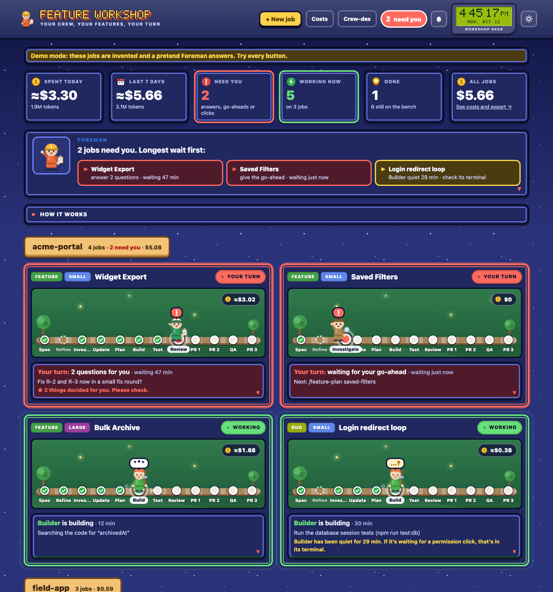
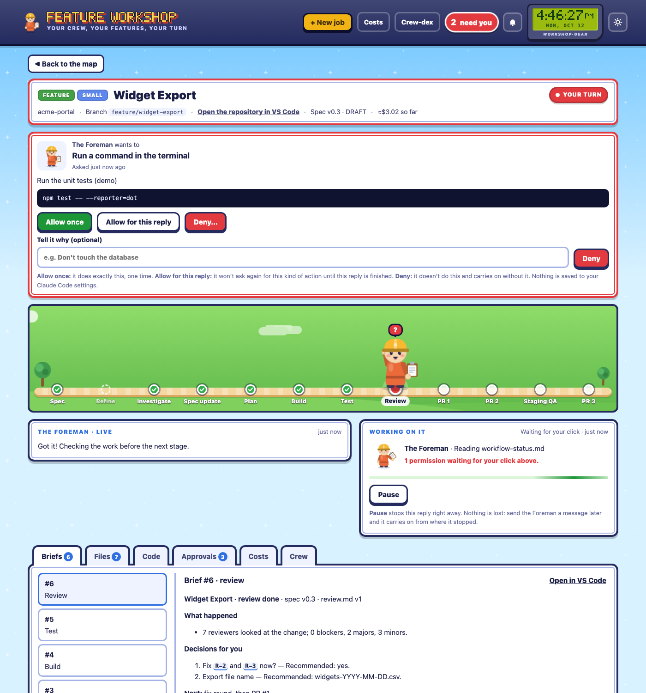

# Feature Workshop

A local dashboard for the Claude Code **feature workflow** (spec → investigate → plan → build → test → review → PRs). It shows every job in progress, which crew member (worker agent) is busy right now, what's waiting for you, and what it all costs. From the browser you can answer the Foreman's questions, approve the next stage, click Allow or Deny when a worker wants to do something, start new jobs and pause running ones.

It runs only on your computer (`127.0.0.1`) and uses your own Claude Code login.



## Quick start

You need **Node.js 22+**, **git**, and **Claude Code** installed and logged in (`claude` works in your terminal).

```sh
git clone https://github.com/vigneshrs-moxie/feature-workshop.git
cd feature-workshop
npm install
npm run web:build
```

`npm run web:build` builds the new view (the React app in `web/`); run it again after pulling changes. The dashboard serves the new view at **/next/** and the classic view at **/**. Both show the same jobs live and wear the theme you pick in the new view's Settings; each has a button to the other (**Classic view** / **New view**, on the same page).

**Try it safely first:** `npm run demo` opens the dashboard on invented jobs with a *pretend* Foreman. Every button works and nothing real runs or costs anything. (If the real dashboard is already running, use `PORT=4478 npm run demo`.)

**Use it for real:** `npm start`, then open **http://127.0.0.1:4477/next/**. Stop it with **Ctrl+C**. Stopping the dashboard pauses any reply in progress; nothing is lost.

## How it works, in one minute

- **You talk to the Foreman** (the `/feature` conductor). It hands each stage to a crew member (the worker agents) and stops after every stage so you can check it. Nothing moves on without your go-ahead.
- **The board** groups jobs by repository. Each card is one feature or bug: the path from Spec to PR 3, the crew standing at the current stage, and one plain sentence about what's happening.
  - **Red with “!”: your turn.** Answers, a go-ahead, or a permission click.
  - **Green: working.** The characters hammer, write, scan or shake their flask; a bar runs along the bottom.
  - **Grey: resting or paused. Yellow: blocked on someone else. Gold: done.**
- **The Foreman's box** at the top lists what needs you, longest wait first. Click one to open the job.

## Using it day to day

You talk to the **Foreman** and nobody else. It gives you a plain-language overview of each job, you approve, reject or advise, and routine steps happen without bothering you.

**Home** (the new view's landing page, three views at the top):
- **Map:** one row per job, under **Needs you · Running · Idle · Shipping · Done** inside each repo's section (Done folded until you open it). Each row shows:
  - its crew member and title;
  - the **ship track**: five dots, worktree · fork · Moxie branch · staging · main, filled as far as the work has got, with the flag ⚑ on the finish line you chose;
  - one line of words under it ("On your fork · PR #1 (#141) open, checks failing"; the PR opens on GitHub), with the counts as a muted suffix (`main ↑3 ↓0 · 2 not pushed`; behind means: bring main in before the next push);
  - one sentence on the right saying what to do next ("Push 2 commits", "Merge PR #1 on GitHub", "Waiting for a review on PR #2 · 3d", "Nothing to do: waiting for the release").

  The repo's line is its release train: how many commits wait in staging, the open release PR, the last release, and the jobs aboard. Filter chips with counts (All · Needs you · Shipping · a repo), **With recently closed**, and **Show: counts · branches** sit above the rows. Keys: **j / k** move the highlight, **Enter** opens the job, **o** its newest PR, **/** jumps to the chips, **1–4** pick them. The branches are fetched and the PRs read every 10 minutes (read-only: `git fetch` and `gh`), or now with **Refresh**.
- **Table:** the same jobs as rows to sort, filter (Needs you, Running, In review, Shipping, …) and search; its Where column uses the map's words.
- **Desk:** every decision waiting for you across all jobs, one at a time, oldest first.
  - **j / k:** next or previous.
  - **a:** approve the go-ahead or allow the permission once.
  - **d:** deny.
  - **o:** open the job.

  Hard lines and risky steps are never one-key approved.

**Settings** (the gear in the top bar, or `g s`) is one page in sections, a rail on the left and one section at a time on the right: **Permissions · Notifications · Look · Keys · Workflow · Play · Rules**. Each rail row shows the section's current value in one line ("Glass · Text M", "Finish line: PR #1 merged", "3 rules"), so you can read your setup without opening anything. `j` and `k` move between sections, `/` goes to **Find a setting**, which searches every control by name and jumps to it. `#/settings/<section>` opens a section directly. **Workflow** holds the finish line (below) and what a new job starts with: **Screens (wireframes)** and **Clarify questions**, each Auto, Always or Off; Auto draws screens at L2 and L3 when the spec names one, and asks clarify questions when the request leaves a product decision open. A job can change its own under Notes and options. The in-browser alert switches (a notification and a chime while the tab is in the background) live under Notifications as **In this browser**.

**Finish line** (Settings → Workflow): one setting says what counts as a job being done: PR #1 open, PR #1 merged (the default: your part is over, the rest waits on other people), in staging, in main, or only when you mark it done. Marking a job done always counts. Crossing the line is the celebration (the Play quest, the Done notification); a job past it moves to **Shipping** in the Jobs list, where its row says where the work is ("On the Moxie branch", "In staging") and nothing asks you anything. Reaching staging or main after the line is a quiet "Landed" notification, never with a sound. **Done** is in main, or marked done.

**Notifications outside the browser** (Settings → Notifications):
- **What sends them:** the dashboard itself, through macOS, so they reach you with the tab closed. That covers what needs you, problems (an error, the usage limit), and jobs crossing the finish line (then landing in staging or main, quietly).
- **What you can set:** each kind with a sound, silent or off; quiet hours; nothing while you're looking at the dashboard.
- **Clicking one:** it opens that job.

They need `brew install terminal-notifier`. macOS asks once: allow it in **System Settings → Notifications → terminal-notifier**. Until then the built-in notifier shows them, but a click can't open the job.

**The job page, top to bottom:**
- **The Foreman's overview:** where the job stands, what it needs from you, what to watch out for, and what's next. It comes from the Foreman's own latest brief (or, for older jobs, from the job's record), so you don't have to open plan or test files. **Ask the Foreman for a fresh overview** asks it directly.
- **Heads-ups** the dashboard spots itself: the repository isn't known yet, the job's branch is checked out in your main folder (the Foreman builds in its own worktree, which needs that branch free), or Claude Code is open in this repository in a terminal.
- **Your conversation with the Foreman:** its briefs and replies, your messages, the permissions you decided, problems, and a folded list of routine steps handled for you.
- **Your move:** answer, **Approve and continue**, **Ask for changes**, **Stop this job**, or ask a quick question (*Where are we? What do you need from me? Explain the plan simply. Any risks?*).
- **Details** (folded): files, code, approvals, costs and crew, for when you want to dig in.

**Start a job.** Click **+ New job**, describe it in a line, pick Feature or Bug fix, the repository and the Foreman's model (Fable 5.1 is what the workflow is designed for; Opus 5.5 is cheaper; Haiku 5.5 is only for trying things out). The Foreman writes a spec first and stops for your review. You can still start jobs with `/feature …` in a terminal; they show up here too.

**Answer and approve.** Open a red card. The job page shows the Foreman's latest brief and a **Your move** panel:
- your answers to its questions, with the recommended ones already picked,
- anything it **decided on your behalf**, to Confirm, Change or leave for Later,
- **Approve and continue**, **Ask for changes** or **Stop this job**, or send any message.

Before anything is sent you see the **exact words** the Foreman will receive, and you can edit them. They're also kept in the job's activity log.



**Routine steps run on their own; risky ones come to you.** The rules follow the workflow's own gates:
- **Handled for you** (and listed in the conversation): reading anything; the Foreman handing work to its crew; writing the job's own records; writing the spec during the spec stages; and, once you've approved a plan, editing, committing and running the checks your test plan allows (lint, typecheck, unit tests, build) inside the job's own worktree.
- **Always asks you:** pushing, PRs, merging, resetting or switching branches, migrations and database tests, starting servers, installing packages, deleting files, anything that reaches the internet, editing anything outside the job's folders (your main folder included), complex shell commands, and anything Claude Code itself flags as risky.

Prefer to approve everything yourself? Choose **Ask me about every step** under the bell (*Alerts and settings*) or on the job page.

**Permissions.** When something does need your OK, a card appears on the job page and in a tray on every other page:
- **Allow once:** it does exactly this, one time.
- **Allow for this reply:** it won't ask again for this kind of action until the current reply is finished. Handy during building, when there are many edits. It is kept in memory only.
- **Deny:** it doesn't do this and carries on without it. You can add a note saying why.

Nothing is ever saved to your Claude Code settings. Your existing settings still apply: anything you already allow in Claude Code won't ask here either. Requests with no time limit simply wait for you.

**Pause and stop.** While the Foreman works, **Pause** stops the current reply right away; send a message later and it carries on. **Stop this job** asks the Foreman to record where things stand and stop.

**Jobs started in a terminal.** Every job shows up on the board, wherever it was started, because the board reads the jobs' folders. Only one place drives a Foreman at a time, so:
- The dashboard sees which Claude Code sessions are **open in a terminal right now** (from your computer's process list) and in which folder. If any are open in a job's repository, it tells you and won't start a second Foreman for that job until you confirm none of them is its Foreman. Keep talking to it in the terminal, or close it there (`/exit`) and continue here.
- If a job's session keeps a log and was last used in a terminal, the page offers **Take over here**, which resumes that exact session with its memory. Go back later with `claude --resume <session id>` (shown on the page).
- Some terminal sessions keep no log, for example sessions started from inside another Claude Code session (they inherit `CLAUDE_CODE_CHILD_SESSION`). The dashboard can't read those conversations. Turn on the **live link** (below) to see what they're doing as it happens, or start `claude` from a fresh terminal window.

**Which repository and branch?** The dashboard works it out from the job's `status.json`, its `workflow-status.md` (including free text), the spec's location, the Foreman's session folder, and git branches and worktrees named after the job. If it still can't tell, the job page asks you once (**Choose it** / **Change**) and remembers.

### The live link (optional)

To see terminal sessions live (what they're doing, and when they're waiting for a permission click), add a small hook to your Claude Code settings. It records events for this dashboard only, drops file contents, and never changes what Claude Code does. In `~/.claude/settings.json`, under `"hooks"`, add this entry to each of `SessionStart`, `UserPromptSubmit`, `PreToolUse`, `PostToolUse`, `Notification`, `PermissionRequest`, `Stop`, `StopFailure`, `SubagentStop` and `SessionEnd` (next to any hooks you already have):

```json
{ "matcher": "*", "hooks": [ { "type": "command", "command": "/path/to/feature-workshop/dashboard/hooks/record.mjs" } ] }
```

Events land in `~/.feature-workshop/hook-events/events.jsonl`. Remove the entries to turn it off.

**Details on demand** (tabs on the job page): **Briefs** (every saved brief), **Files** (spec, findings, plans, reports, each review; requirement IDs like `FR-001` are clickable and show where they're defined and mentioned), **Code** (one commit per plan step, with diffs and *Open in VS Code* links), **Approvals** (the job's approval record, superseded ones marked, plus everything sent from here), **Costs** (by stage, crew member and model) and **Crew** (who worked on the job and what they did last).

**Costs.** The **Costs** page totals every job, splits it by model and by job, and shows what the Foreman's part would have cost on another model, which makes comparing setups easy. **Download CSV** or **Download report (Markdown)** to hand on. Numbers use Claude Code's own cost figure where it recorded one; otherwise they're estimates from token counts (marked ≈). Prices are listed in `dashboard/lib/cost.js`. These are estimates, not a bill.

**Alerts.** The bell turns on browser notifications and/or a soft chime for when a job needs you. They work while the page is open in a tab.

**Look.** The sun button cycles automatic, day and night. Click the clock to switch 12/24-hour time. **Crew-dex** introduces every crew member with their model.

### How much process a job gets

**New job** asks for the job's **level** (in both views), and you can change it later (the level chip in the new view's job header, or **Notes and options** in its job menu):

| Level | What runs |
|---|---|
| **L0 Tweak** | One build, then the checks; you look at the diff. No plan to approve. |
| **L1 Small** | A quick plan you approve, then build, checks, you try it, one reviewer. |
| **L2 Standard** | A short spec and plan you approve, build in steps, the tester, you try it, 3–4 reviewers. |
| **L3 Large** | Spec, product interview, investigation, a plan you approve, build in steps, the tester, you try it, every reviewer plus Fable. |

Leave it unpicked and the Foreman proposes one in its first brief. **Notes and options** also hands over documents you already have, skips stages, picks reviewers, fix rounds, models and Fable second looks, and keeps notes for the Foreman. You still approve what gets built before any code changes.

The options live in the job's private folder as `options.json`; the Foreman reads them before every stage (this needs the matching workflow update in `~/.claude/skills/feature/`).

### Marking a job done

**Mark as done…** on a job's page takes it off the board when it's finished, waiting on someone else's merge, or not going ahead: pick **Done** or **Dropped** and add a note if you like. It moves into **Finished** at the bottom of the board; nothing is deleted and the Foreman isn't contacted. **Reopen** brings it back (so does sending its Foreman a message). Optionally it also removes the job's worktree, only when nothing would be lost: no uncommitted changes or hidden local edits, no ignored files except ones that come back by themselves (installed packages, build output, the settings file the job page made), its latest commit already on GitHub, and nothing still working in it (a command from the job page, a crew member, a terminal). The branch is always kept. If a removal is cut short, the page says so and how to finish it. A job you marked comes back on the board by itself if it changes afterwards (for example the Foreman asks you something).

### Start from a past conversation (History)

**History** in the top bar lists every conversation you've had with Claude Code on this computer (read from `~/.claude/projects`), newest first, with its title, first message, repository, branch, files changed and PRs. Open one to see what was asked and how it ended, then **Make it a job**: New job opens filled in from it, and you pick the flow and options as usual. Two ways for the Foreman to pick it up:

- **Fresh Foreman with a summary** (recommended): the dashboard writes a short extract (`history.md`) into the job's private folder and a fresh Foreman reads it. Cheap and a clean start.
- **Continue that conversation**: a copy of it (Claude Code's own fork; the original is untouched) becomes the Foreman, so it remembers everything. Costs more on every reply.

Either way the earlier conversation is background, never approval: every plan still needs your yes in the job. Conversations a job already uses, the dashboard's own runs and test runs are hidden unless you tick them. Some terminal setups don't save conversation logs; those are listed as "no saved log" and can't be used.

### Try it on your computer

Each job with a worktree has a **Try it on your computer** panel on its page, for testing the work by hand next to your main app:

- **▶ Try it** does everything missing in one go: prepares the job's settings file, offers to switch the local database to the job's branch, starts the app on the job's own port (3001, 3002, …) and gives you the link.
- **Settings file:** copies your main folder's `app/.env.local` into the worktree (only if git ignores it there), points its own-address settings (`AUTH_URL`, `NEXT_PUBLIC_APP_URL`, …) at the job's port and turns on the app's local sign-in skip (`DEV_BYPASS_AUTH=true`) when the file has one. Your main folder's file is never changed, and values never reach the page.
- **Database** (apps with an `applied_migrations` ledger and an `npm run db:migrate` script, on a local Postgres): the first switch saves your database as **the original** (`<name>__original`). **Match this job** rebuilds the local database from the original and adds the branch's migrations; **Put the original back** restores it. Switching needs nothing connected to the database: apps started here stop first, and you stop your main app's dev server yourself. Anything changed in the local database since the last switch is lost (the page says so before it starts).
- **Quick commands** (checks, tests, types, lint, build, migration status, git status), a **command box** that runs anything in the job's folder with live output (↑/↓ for history), and **Open terminal here** (iTerm or Terminal), VS Code and Finder.

Commands run without a terminal, so ones that ask questions won't work there; open a terminal for those. Apps and commands started here stop when the dashboard stops.

### Usage limits

When a reply run from here hits Claude's 5-hour or weekly limit, every reply still going is paused and a banner at the top of each page says which limit, which jobs, and when they carry on. Once the limit resets (plus a minute and a half), each paused job is told to carry on from where it stopped. **Carry on now** skips the wait (for example after you turn on extra usage), and the switch beside it turns automatic carry-on off. A heads-up shows when Claude warns you're close. Jobs running in a terminal can't be paused from here.

## What it reads and what it changes

**Reads (never changes):**
- `~/.claude/feature-work/*/` — each job's `workflow-status.md`, `status.json`, `briefs/` and artifacts
- `~/.claude/projects/` — Claude Code session logs, for live activity and cost (never sent anywhere)
- `~/.claude/agents/*.md` — each worker's model and effort, for the Crew-dex
- your repositories, read-only with git (`git log`, `git show`) for the Code tab, and the spec file each job names

**Writes:** each job's `options.json` and, when it starts from a past conversation, `history.md` (and creates the job's folder when you start a job here); a forked copy of a conversation when you choose to continue one; and its own small state folder, `~/.feature-workshop/`:
- `sessions.json` — which Claude Code session drives each job, and when you took one over
- `audit.jsonl` — every message sent, permission decided, routine step handled, pause and take-over, with the exact words
- `settings.json` — how routine steps are handled, a usage-limit pause in progress, each job's local port, the terminal app, and which job the local database matches

**Everything else happens through the job's Foreman session in Claude Code**, except what you start from **Try it on your computer**: on your click, that runs the job's app, your commands and database switches in the job's worktree, writes the worktree's `.env.local`, and copies or restores your local database. You start every reply; within it, routine steps run under the rules above and everything else asks you. The dashboard itself never pushes, opens PRs, changes Claude Code settings or talks to anything except your local Claude Code (and your local database, when you switch it). It also reads the list of running processes (`ps`, `lsof`) to spot open Claude Code terminals, and `~/.feature-workshop/hook-events/` if you turn on the live link.

## Can and can't

| It can | It can't (by design) |
|---|---|
| Show every job, who's working and what they're doing, live | Approve anything risky without your click |
| Send your answers, approvals and messages to a job's Foreman | Drive a session that's open in a terminal (you take it over first) |
| Start new jobs and pause or stop running ones | Change your Claude Code settings or permission rules |
| Handle routine steps itself and send you only the risky ones | Run when your computer's Claude Code isn't logged in |
| Export costs as CSV and Markdown | Be reached from another computer |
| Run a job's app, commands and database switches on your click | Touch a database that isn't on this computer |
| Pause jobs at Claude's usage limit and carry them on after it resets | Pause Claude Code sessions running in a terminal |

## Security

- Listens on `127.0.0.1` only and rejects requests addressed to any other host name.
- Anything that changes something needs a secret token that only this page can read, from this page's own address, as JSON. Other websites open in your browser can't press its buttons.
- Strict content security policy: the page loads only its own files, no outside scripts or styles.
- Markdown is rendered with raw HTML switched off and unsafe links removed.
- Git is read with fixed commands and checked arguments; files are only read from inside each job's folder or the spec path the job records.
- The command box runs what you type, as you, in the job's worktree: treat the page like a terminal. Database switches run fixed programs (`createdb`, `dropdb`, `npm run db:migrate -- <name>`) with no shell, only for a Postgres on this computer, and refuse while anything is connected.

## Settings (environment variables)

| Variable | Default | What it's for |
|---|---|---|
| `PORT` | `4477` | The port to listen on |
| `WORKSHOP_FEATURES_DIR` | `~/.claude/feature-work` | Where jobs live |
| `WORKSHOP_PROJECTS_DIR` | `~/.claude/projects` | Claude Code session logs |
| `WORKSHOP_AGENTS_DIR` / `WORKSHOP_SKILLS_DIR` | `~/.claude/agents` / `~/.claude/skills` | The workflow's agents and skills |
| `WORKSHOP_STATE_DIR` | `~/.feature-workshop` | The dashboard's own state |
| `WORKSHOP_CLAUDE_PATH` | (bundled with the SDK) | Use a specific `claude` executable |
| `WORKSHOP_EXTRA_REPOS` | (none) | Extra repositories to offer in New job, separated by `:` |

## Sharing with teammates

Each person runs their own copy: clone, `npm install`, `npm start`. It uses **their** Claude Code login and shows **their** jobs and costs; nothing is shared between people, and no credentials are stored in this repo. Before rolling it out widely, check with whoever manages your Anthropic account that driving Claude Code sessions this way is fine for your plan.

Teammates also need the feature workflow itself (the `/feature` skills and `feature-*` agents). Those currently live in one person's `~/.claude` with some personal paths. The next step is to package them as a Claude Code plugin in this repo so `claude plugin install` sets them up.

## How it's built

- Plain Node.js server (`dashboard/server.js`) and a no-build front end (`dashboard/public/`).
- Two dependencies: the [Claude Agent SDK](https://www.npmjs.com/package/@anthropic-ai/claude-agent-sdk) to run Foreman sessions, and `markdown-it` to render briefs and artifacts.
- `dashboard/lib/` holds the readers (workflow files, session logs, git, costs), the driver that runs replies and parks permission requests, and the message composer.
- `npm test` runs the tests (Node's built-in runner): parsers, costs and exports, Markdown safety, git, request safety, the routine-step rules, usage-limit pause and carry-on, local settings files and ports, the driver with a pretend session, and the demo Foreman.

## Known limits

- **Terminal sessions without logs** (see above) show as open terminals only, unless the live link is on.
- **No time limits.** A worker counts as working until its log shows it finished. If a terminal session is closed mid-task, its job keeps showing as working, with a “quiet for …” note. Jobs paused or finished from the dashboard are always shown correctly.
- **Quiet ≠ stuck.** A long command and a permission prompt waiting in a terminal look the same in the logs, so the card says “maybe” and points you to the terminal.
- **Older jobs** that don't write `status.json` and `briefs/` yet show less detail (their stage and approvals come from `workflow-status.md`).
- The session log format belongs to Claude Code and may change; unknown lines are skipped.
- Notifications need the page open in a tab, and some browsers limit them.

