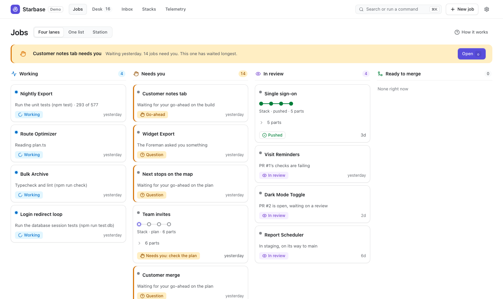
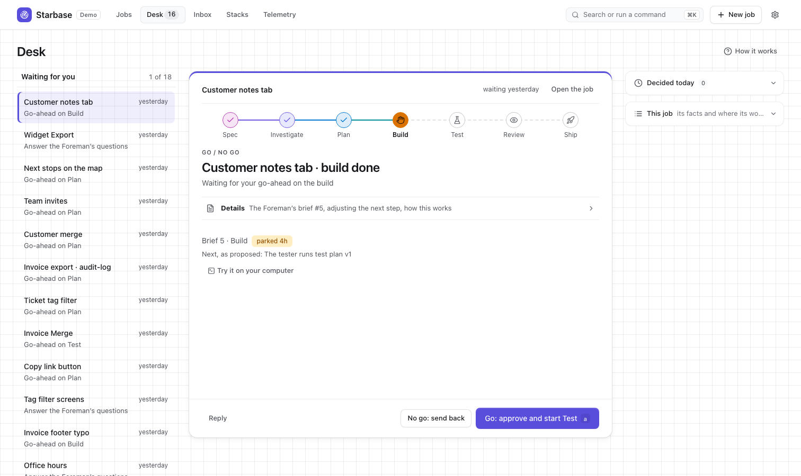
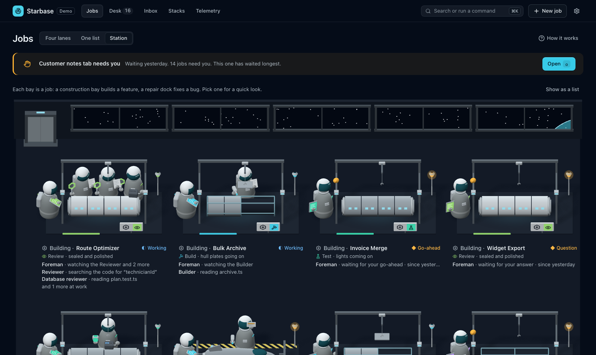

#  Starbase

Starbase runs Claude Code's **feature workflow** for you (spec → investigate → plan → build → test → review → ship) and shows every job in one place. You see what each job is doing, which crew member (worker agent) is busy, what's waiting for you and what it costs. You answer the Foreman's questions, approve the next stage, and allow or deny what a worker wants to do, from your browser or your phone.

It comes in two parts:
- **Starbase on your computer** runs the jobs. It uses your own Claude Code login, and its page is at http://127.0.0.1:4477/next/.
- **The team site** (optional) is a website on Vercel with Google sign-in. Each person pairs their laptop once. You then see your jobs and make decisions from anywhere, see who on the team is around, and fill your Orbit inbox while your laptop is closed. Jobs still run only on the laptops.



## Install

You need Node.js 22 or later, Git, the GitHub CLI (`gh`) and Claude Code, the last two signed in. `starbase doctor` checks all of them and tells you how to get what's missing.

**From a release** (Windows, macOS, Linux): one line installs Starbase and sets it up to start when you sign in. The lines and what they do are in [docs/install.md](docs/install.md).

**From the code** (until a release is published, or to work on Starbase):

```sh
git clone https://github.com/vigneshrs-moxie/feature-workshop.git starbase
cd starbase
npm ci
npm run web:build
npm link
starbase doctor
starbase install
```

- `npm link` gives you the `starbase` command.
- `starbase install` sets up the background service, so Starbase starts when you sign in:
  - macOS: launchd, `com.moxie.starbase`;
  - Linux: `starbase.service`;
  - Windows: the scheduled task "Starbase".
- If you aren't allowed to install a service, use `starbase start --here` and keep that window open, or `npm start`.
- Run `npm run web:build` again after you pull changes.

Then open **http://127.0.0.1:4477/next/**.

**Try it safely first:** `npm run demo` opens Starbase on invented jobs with a pretend Foreman. Every button works, and nothing real runs or costs anything. If Starbase is already running, use `PORT=4479 npm run demo`.

## The `starbase` command

| Command | What it does |
|---|---|
| `starbase start` / `stop` | Start or stop it. Stopping pauses replies in progress; they carry on at the next start. |
| `starbase status` | One screen: the service, repositories, jobs, locks and usage |
| `starbase doctor` | What this computer is missing, and how to get it |
| `starbase repo add <folder>` | Register a repository |
| `starbase token` | Save your Orbit token (for the Inbox) |
| `starbase login --site <address>` | Pair this laptop with the team site, once |
| `starbase logout` | Unpair it |
| `starbase update` | Move to the newest release, after checking its checksum |
| `starbase open <job>` | Open a job's folder in your terminal and editor |
| `starbase install` / `uninstall` | Add or remove the background service (your files stay) |

`starbase <command> --help` says more about each one.

## Connect to the team site

Once the site is set up (the steps are in [docs/hosting/vercel-setup.md](docs/hosting/vercel-setup.md)):

1. Open the site and sign in with your work Google account. Only accounts in your company's domain are let in.
2. On your computer, run `starbase login --site https://<the site's address> --name "My laptop"`.
3. Open the link it prints, check the code matches the one in your terminal, and press **Pair this laptop**.
4. On the site, go to Settings → Orbit and paste your Orbit token. The Inbox then fills every few minutes, even while your laptop is off.

Your jobs now show on the site. A decision you make there while your laptop is asleep waits, marked "waiting for your laptop", and runs when the laptop wakes. Each person sees only their own jobs.

## The pages

| Page | What it's for |
|---|---|
| **Jobs** | Every job, as **Four lanes** (Working · Needs you · In review · Ready to merge), **One list**, or the **Station** (below). |
| **Desk** | Every decision waiting for you, one at a time, oldest first: **Go** or **No go**, with the Foreman's brief behind Details. Keys: `j`/`k` next or previous, `a` approve, `d` deny, `o` open the job. |
| **Inbox** | Your Orbit tickets. **Start** makes a ticket into a job. |
| **Stacks** | Big jobs split into parts that merge one after another. |
| **Telemetry** | The shared Claude account's 5-hour and weekly limits, who used them, and your own costs by stage and by ticket. |
| **Lounge** (team site) | Who on the team is online, away or off, and what's running on their laptops. |
| **Settings** | Permissions · Notifications · Look · Keys · Workflow · Repos · Play · Rules. |



**The job page** shows the Foreman's overview, the conversation with it, **Your move** (answer, approve, ask for changes, stop), and Details: files, code, approvals, costs and crew.

**Search or run a command** (`⌘K`, or `Ctrl+K` on Windows) finds any job, page or setting.

## How a job runs

- **You talk to the Foreman** (the `/feature` conductor). It hands each stage to a crew member and stops after each one for you to check. Nothing moves on without your go-ahead.
- **Start a job** with **+ New job** (a line describing it, Feature or Bug fix, the repository, the level and the model), from a ticket in the Inbox, or with `/feature …` in a terminal. Jobs started in a terminal show up too.
- **Levels** set how much process a job gets:

  | Level | What runs |
  |---|---|
  | **L0 Tweak** | One build, then the checks; you look at the change. |
  | **L1 Small** | A quick plan you approve, build, checks, you try it, one reviewer. |
  | **L2 Standard** | A short spec and plan, build in steps, the tester, you try it, 3–4 reviewers. |
  | **L3 Large** | Spec, product interview, investigation, plan, build in steps, the tester, you try it, every reviewer. |

- **Clarify and Screens.** On larger jobs the Foreman may open with a few questions, and it can draw the feature's screens for you to review before anything is built.
- **Routine steps run on their own; risky ones come to you.** Reading, writing the job's own records and, once you've approved a plan, editing, committing and running the checks inside the job's own worktree are handled for you. Pushing, PRs, merging, migrations, installing packages, deleting files, reaching the internet, and anything outside the job's folders always ask you. Some things, like force-pushing, are always refused.
- **Permissions:** **Allow once**, **Allow for this reply** or **Deny**, with a note if you like. Settings → Rules keeps the rules you chose to save.
- **Finish line** (Settings → Workflow): what counts as done, from "PR #1 open" to "in main". By default it's PR #1 merged.
- **Usage limits:** when Claude's 5-hour or weekly limit is reached, running replies pause, and they carry on by themselves after the reset.
- **Try it on your computer:** each job can start its app on its own port, copy your settings file, switch your local database to the job's branch, and run quick commands, all in the job's worktree.

## Look and Play

There are 13 themes in Settings → Look (two are unlocked through Play), including **Light** (the default) and the **Starbase** pair (night and day). Look can follow your system's light or dark setting.

**Play** (Settings → Play) adds a crew that acts out what each job is really doing, with achievements and the Crew-dex. **Subtle** keeps it small. **Full** adds the **Station**: a 3D deck where a feature is a construction bay and a bug fix is a repair dock with hazard stripes. Every state is also written in words, and the 3D view has a plain list beside it. **Off** turns all of it off.



## What it reads and changes

**On your computer, read only:**
- the jobs in `~/.claude/feature-work/`;
- Claude Code's session logs in `~/.claude/projects/`, for live activity and cost;
- the workflow's agents;
- your repositories, with read-only git.

**It writes:**
- each job's options;
- its own folder, `~/.starbase/` (sessions, settings, rules and `audit.jsonl`, which records every message sent and permission decided, word for word).

Everything else happens through the job's Foreman session, under the rules above. Starbase never changes your Claude Code settings.

**The team site keeps:**
- who signed in;
- the paired laptops;
- a mirror of each job's record;
- queued decisions;
- an audit copy;
- each person's Orbit token, encrypted;
- screenshots from checks, in private storage.

It never runs jobs or reaches your repositories. Laptops connect to it over HTTPS, using a token from pairing.

## Security

- **On your computer:**
  - Starbase listens on `127.0.0.1` only and refuses other host names.
  - Every change needs a token only its own page can read, so other websites can't press its buttons.
  - A strict content security policy means the page loads only its own files.
  - A job's screens page is served from a separate port, so its script can't reach Starbase.
- **On the team site:**
  - Google sign-in is limited to your company's domain.
  - Sessions are signed, Orbit tokens are encrypted, and secrets live only in Vercel's settings.
- **The Try it command box** runs what you type, as you, in the job's worktree. Treat it like a terminal.

## Settings (environment variables)

| Variable | Default | What it's for |
|---|---|---|
| `PORT` | `4477` | The port to listen on |
| `WIREFRAMES_PORT` | `PORT` + 1 | The screens server's port |
| `STARBASE_FEATURES_DIR` | `~/.claude/feature-work` | Where jobs live |
| `STARBASE_PROJECTS_DIR` | `~/.claude/projects` | Claude Code session logs |
| `STARBASE_AGENTS_DIR` / `STARBASE_SKILLS_DIR` | `~/.claude/agents` / `~/.claude/skills` | The workflow's agents and skills |
| `STARBASE_STATE_DIR` | `~/.starbase` | Starbase's own folder |
| `STARBASE_CLAUDE_PATH` | (bundled) | Use a specific `claude` executable |
| `STARBASE_EXTRA_REPOS` | (none) | Extra repositories to offer in New job |

The team site's own settings are listed in [docs/hosting/vercel-setup.md](docs/hosting/vercel-setup.md).

Starbase had other names before. The old command, variable names and folder still work for now; [CHANGELOG.md](CHANGELOG.md) says how they move over.

## How it's built

| Folder | What's in it |
|---|---|
| `dashboard/` | The Node.js server on your computer: it reads the jobs, drives Foreman sessions through the [Claude Agent SDK](https://www.npmjs.com/package/@anthropic-ai/claude-agent-sdk), parks permission requests, and links to the team site. The older page, the classic view, is still at `/`. |
| `web/` | The page (React and Vite), used both on your computer and on the site |
| `hosted/` | The team site for Vercel: one function, Neon Postgres, private Blob storage, and a cron job that fills the Orbit inbox |
| `bin/` | The `starbase` command |

**Tests**, with no model calls:

```sh
npm test                          # the server on your computer
npm test -w hosted                # the team site
cd web && npx vitest run          # the page
cd web && npx tsc --noEmit -p .   # the page's types
```

GitHub runs the tests on Windows and macOS on every push.

## Known limits

- **Jobs run only on laptops.** A closed laptop's decisions wait for it to wake.
- **Some terminal sessions keep no log** (for example ones started from inside another Claude Code session), so Starbase shows them only as open terminals. The optional live link hook, `dashboard/hooks/record.mjs`, shows them as they happen.
- **A quiet session isn't always a stuck one.** A long command and a permission prompt in a terminal look the same in the logs, so the card says "maybe" and points you to the terminal.
- **Claude Code's session log format can change.** Lines Starbase doesn't recognise are skipped.
