# Theme mockups, round 2 (2026-10-15)

Real screenshots of the phase 1 Workshop UI in each candidate theme after the polish pass,
taken from the demo (fake Foreman, invented jobs) in headless Chrome at 1440×900, 2× scale.
Every theme shows the same content: the demo was restarted before each theme (rules cleared,
permission policy "Routine steps automatic"), and the same eight screens were captured in the
same order. Only looks differ; layout, text and controls are identical by design (see
`web/src/theme/THEMING.md`). This round replaces the round-1 images.

Nothing here is final. Pick one, mix ideas from several, or send all of them back.

The eight screens:

| # | Screen | What it shows |
| --- | --- | --- |
| 01 | Shell | Jobs list with a running job (Bulk Archive) open in the Foreman pane |
| 02 | Brief with questions | Widget Export: a thread of briefs, the last with decisions for you |
| 03 | New job sheet | The sheet behind the New job button |
| 04 | ⌘K palette | The command palette over the shell |
| 05 | Permission card (hard line) | A `git push` ask: the Hard line label and the "careful look" strip |
| 06 | Steer in progress | A reply running, your steer delivered, Stop and Steer at the foot |
| 07 | Settings | Permissions, Always-allow rules and the theme picker |
| 08 | Jobs list only | The shell with no job open |

The colour language is shared by every theme, so what you learn in one carries to the rest:
needs-you is hot pink or magenta (the loudest thing on screen), running is cyan or teal, paused
is amber, idle is lavender or blue-grey, done is green; a permission ask is orange, a question
is violet, a hard line is red, and a step blocked by auto mode is slate grey. Colours below are
read from each theme's CSS (`web/src/theme/themes/<id>.css`) and given as written there, in
`oklch(lightness chroma hue)`; `fg` is the text and glyph colour, `bg` the row or card tint,
`line` the edge (stripe, outline, sticky tab, card border). Where the CSS names a palette
variable, the resolved value is shown with the variable's name in brackets.

## default

The plain dark look phase 1 shipped with: quiet greys and one indigo accent. Here as the
baseline so the others can be judged against it. Status colour is muted (amber for needs-you,
blue for running, grey for paused) and every ask card has the same indigo border, which is what
prompted this round.

| | | | |
| --- | --- | --- | --- |
| 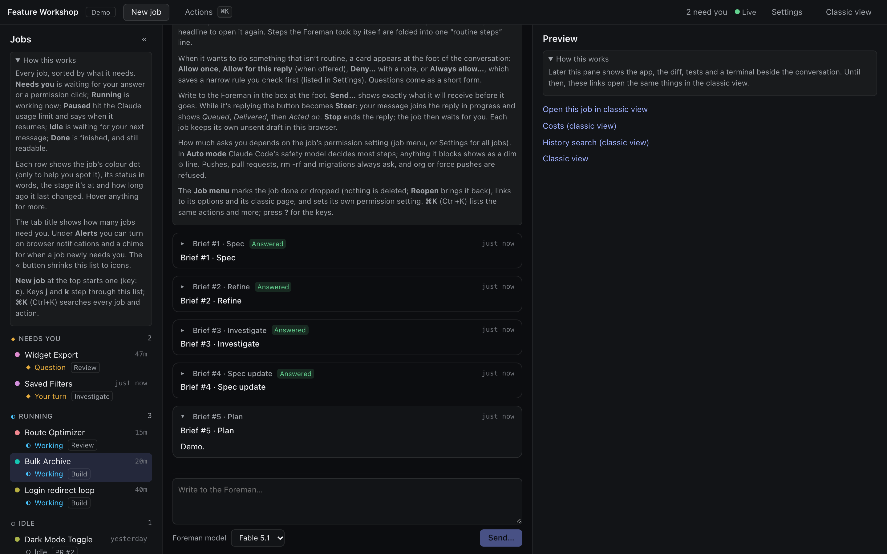 | 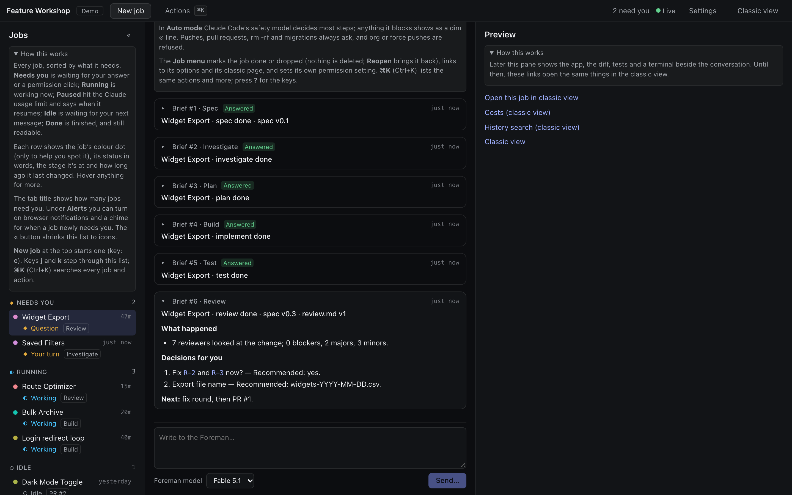 | 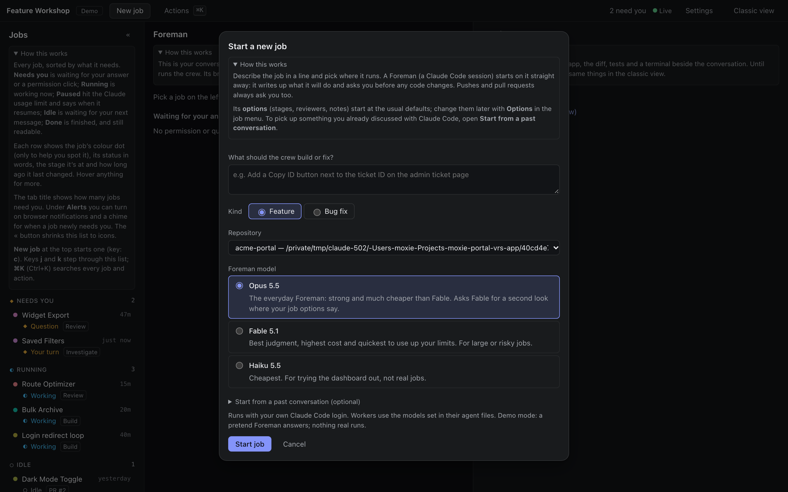 | 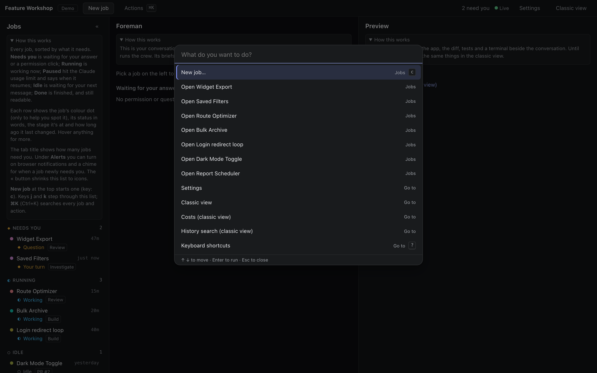 |
| 01 Shell | 02 Brief with questions | 03 New job sheet | 04 ⌘K palette |
| 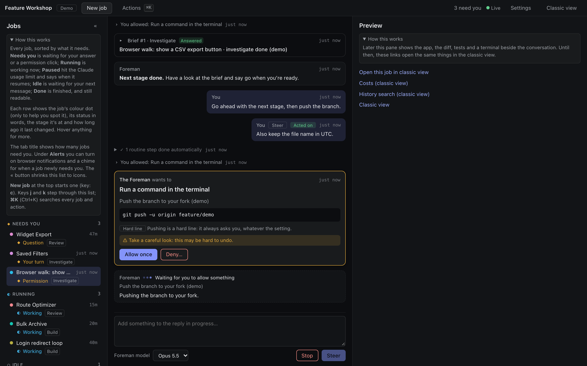 | 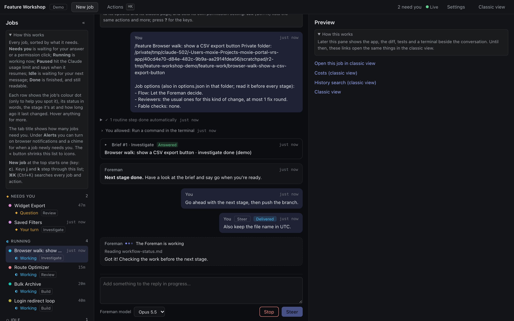 | 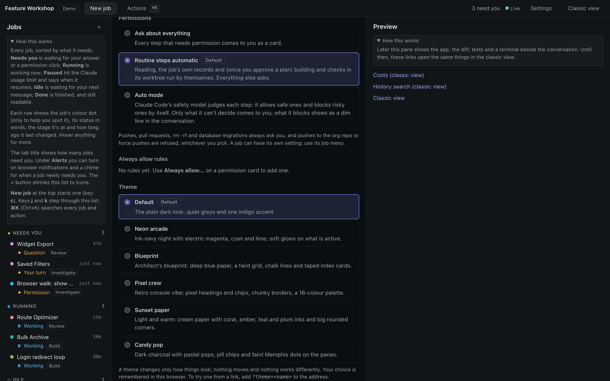 | 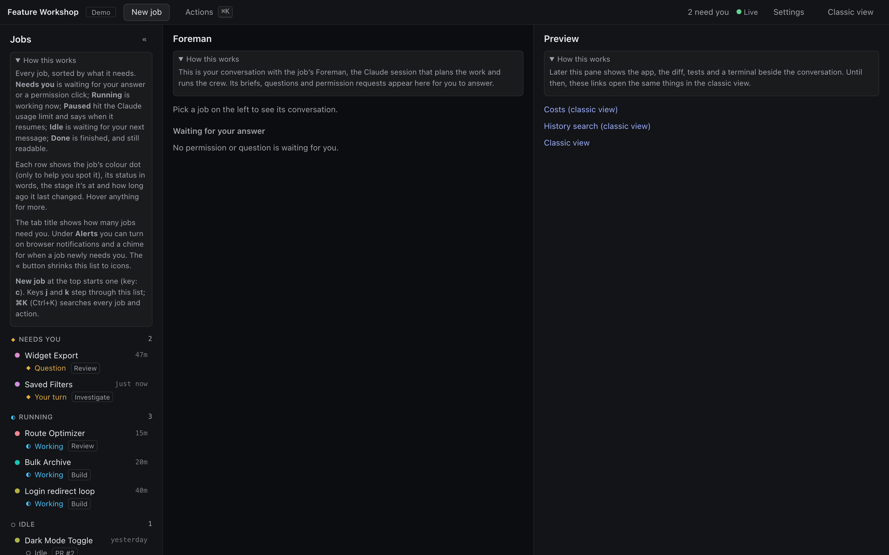 |
| 05 Permission card (hard line) | 06 Steer in progress | 07 Settings | 08 Jobs list only |

Status colour key (the semantic tokens point at the base tokens; values from `tokens.css`):

| Token | fg | bg | line |
| --- | --- | --- | --- |
| needs-you | `oklch(.78 .14 80)` (amber, `--status-warn`) | `oklch(.78 .14 80 / .14)` | `oklch(.78 .14 80)` |
| running | `oklch(.78 .14 235)` (blue, `--status-info`) | `oklch(.78 .14 235 / .14)` | `oklch(.78 .14 235)` |
| paused | `oklch(.7 0 0)` (grey) | `oklch(.7 0 0 / .12)` | `oklch(.7 0 0)` |
| idle | `oklch(.72 .01 260)` (`--text-2`) | `oklch(.25 .006 260)` (`--bg-3`) | `oklch(1 0 0 / .1)` (`--border-2`) |
| done | `oklch(.78 .14 155)` (green, `--status-ok`) | `oklch(.78 .14 155 / .14)` | `oklch(.78 .14 155)` |
| permission | `oklch(.72 .01 260)` (`--text-2`) | `oklch(.22 .006 260)` (`--bg-2`) | `oklch(.7 .15 275)` (indigo `--accent`) |
| question | `oklch(.72 .01 260)` | `oklch(.22 .006 260)` | `oklch(.7 .15 275)` |
| hardline | `oklch(.72 .01 260)` | `oklch(.22 .006 260)` | `oklch(.7 .15 275)` |
| blocked | `oklch(.58 .01 260)` (`--text-3`) | transparent | `oklch(1 0 0 / .1)` |

## neon-arcade

Deep ink-navy night with electric magenta, cyan and lime accents. Soft glows sit on active
things (the open job, a card waiting for you, the live row), never on text, so it stays crisp.
Job dots are lit in their own hue and the group headers read like neon signs. Futuristic and
fun, with the loudest needs-you of the set. Round 2 made needs-you louder still, lifted the
small text so it reads on the navy, and lit the help folds.

| | | | |
| --- | --- | --- | --- |
| 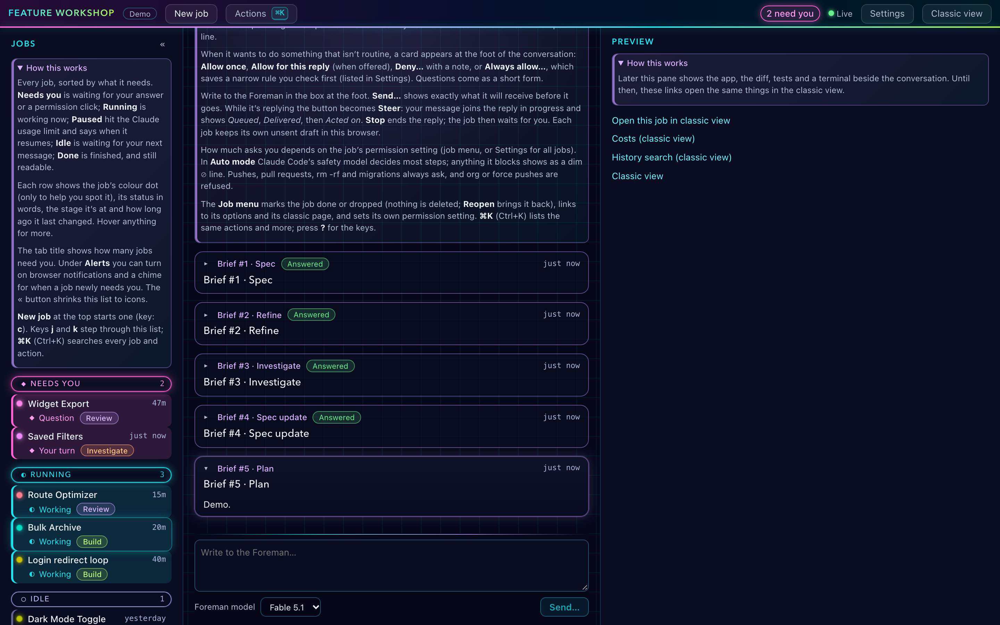 | 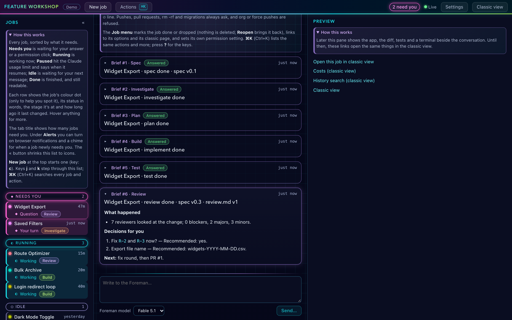 | 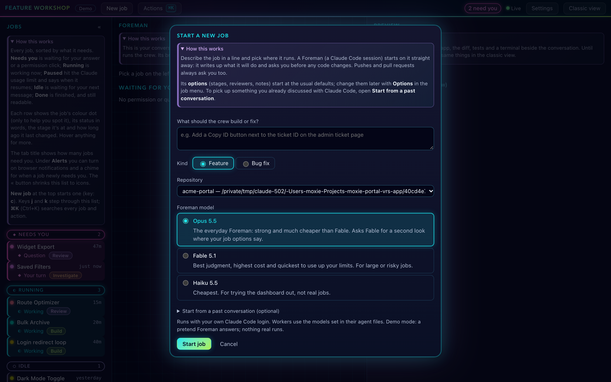 | 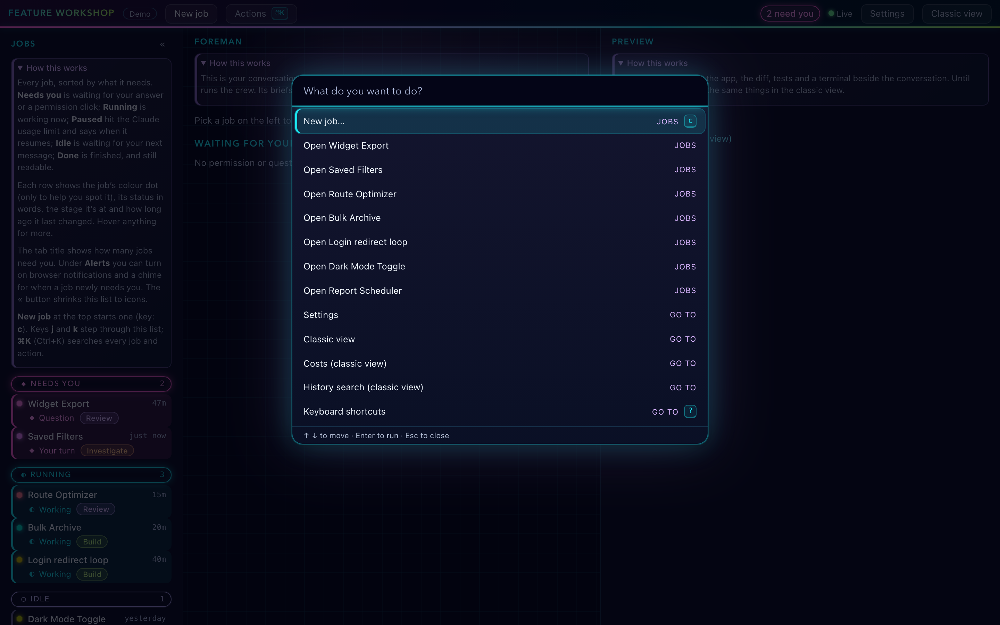 |
| 01 Shell | 02 Brief with questions | 03 New job sheet | 04 ⌘K palette |
| 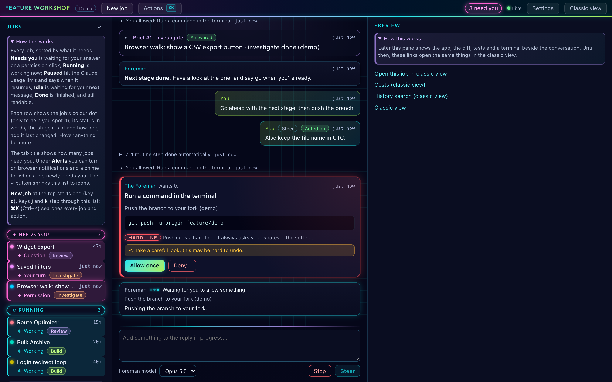 | 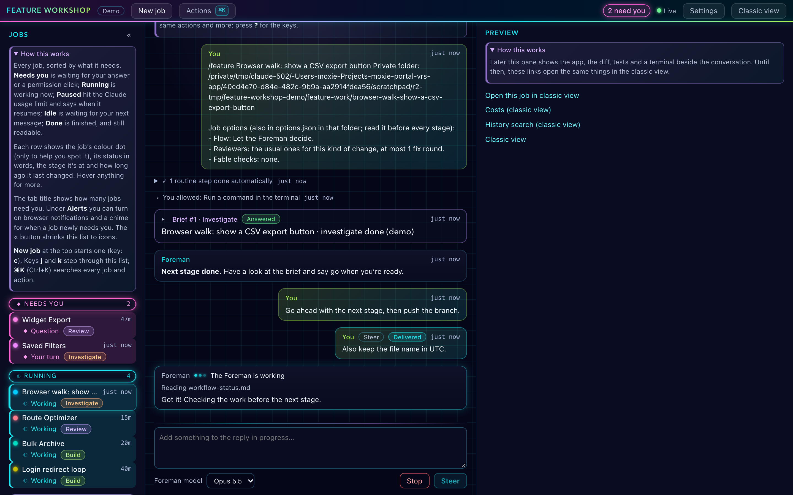 | 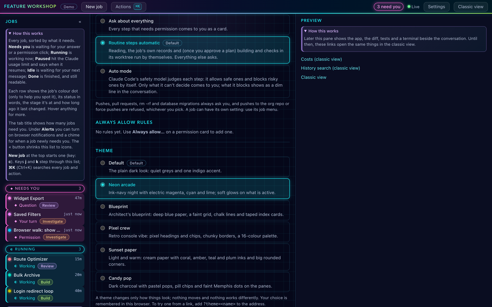 | 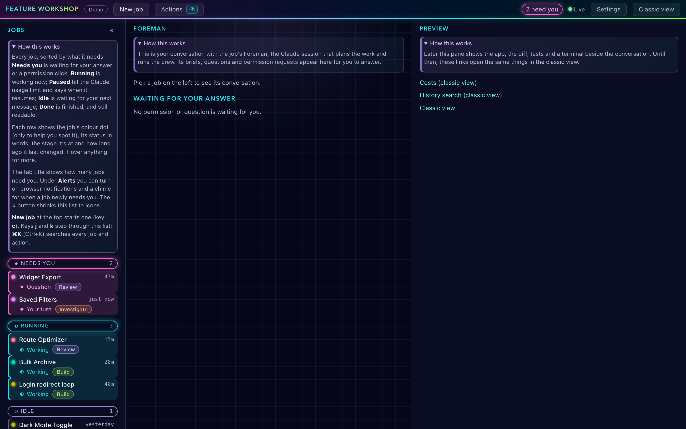 |
| 05 Permission card (hard line) | 06 Steer in progress | 07 Settings | 08 Jobs list only |

Status colour key:

| Token | fg | bg | line |
| --- | --- | --- | --- |
| needs-you | `oklch(.87 .19 345)` (magenta) | `oklch(.76 .24 345 / .14)` | `oklch(.76 .24 345)` (`--na-magenta`) |
| running | `oklch(.84 .14 200)` (cyan, `--na-cyan`) | `oklch(.84 .14 200 / .12)` | `oklch(.84 .14 200)` |
| paused | `oklch(.87 .16 82)` (amber) | `oklch(.86 .16 82 / .12)` | `oklch(.82 .17 78)` |
| idle | `oklch(.82 .08 290)` (lavender) | `oklch(.8 .08 290 / .08)` | `oklch(.7 .1 290)` |
| done | `oklch(.87 .18 150)` (green) | `oklch(.86 .18 150 / .12)` | `oklch(.82 .2 150)` |
| permission | `oklch(.86 .16 60)` (orange) | `oklch(.19 .05 275)` | `oklch(.78 .17 55)` |
| question | `oklch(.84 .14 300)` (violet) | `oklch(.19 .05 285)` | `oklch(.76 .16 300)` (`--na-violet`) |
| hardline | `oklch(.85 .17 22)` (red) | `oklch(.19 .05 275)` | `oklch(.7 .22 22)` |
| blocked | `oklch(.78 .02 260)` (slate) | transparent | `oklch(.6 .02 260)` |

## blueprint

An architect's blueprint: deep blue paper with a faint grid, white and chalk line art, and the
thread's cards drawn as taped index cards (cream paper, a strip of tape at the top) with a
coloured sticky-tab status down the side. Headings are hand-set caps in a clean geometric
font, not handwriting. A nod to Workshop, Foreman and crew. Round 2 made the sheet fold
readable, coloured the asks by kind, and tinted the group headers.

| | | | |
| --- | --- | --- | --- |
| 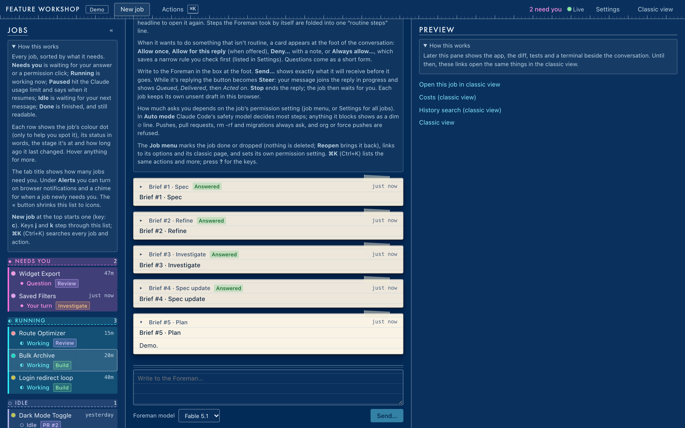 | 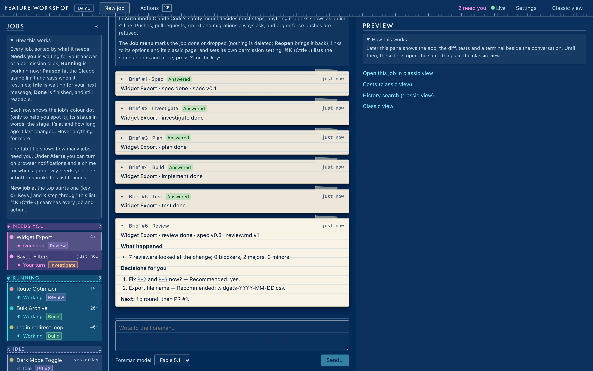 | 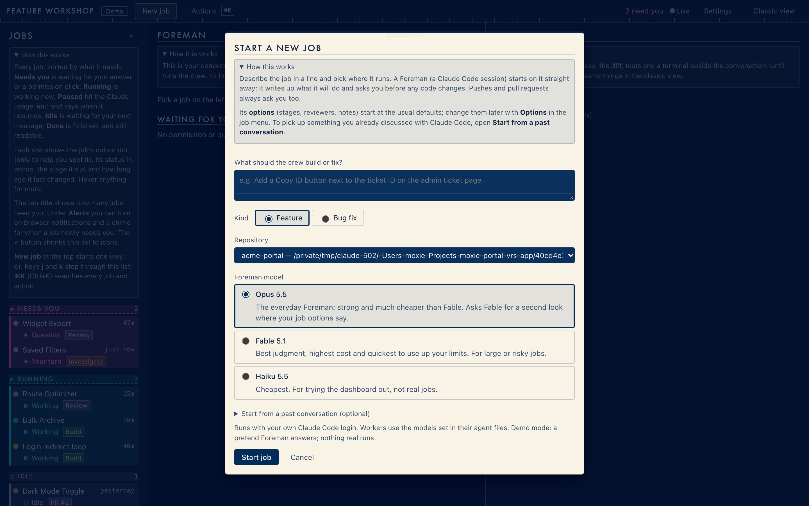 | 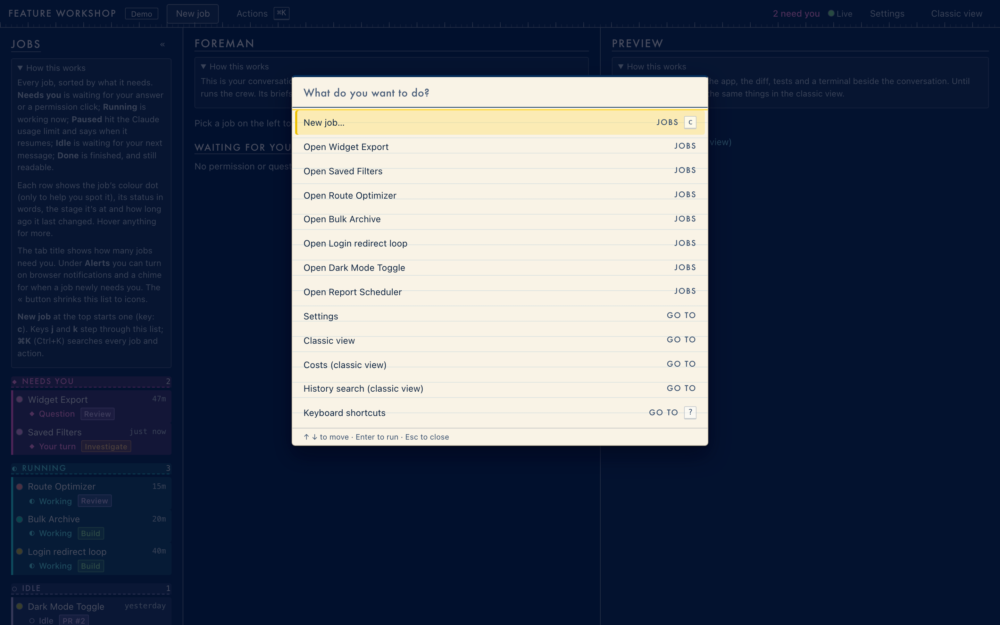 |
| 01 Shell | 02 Brief with questions | 03 New job sheet | 04 ⌘K palette |
| 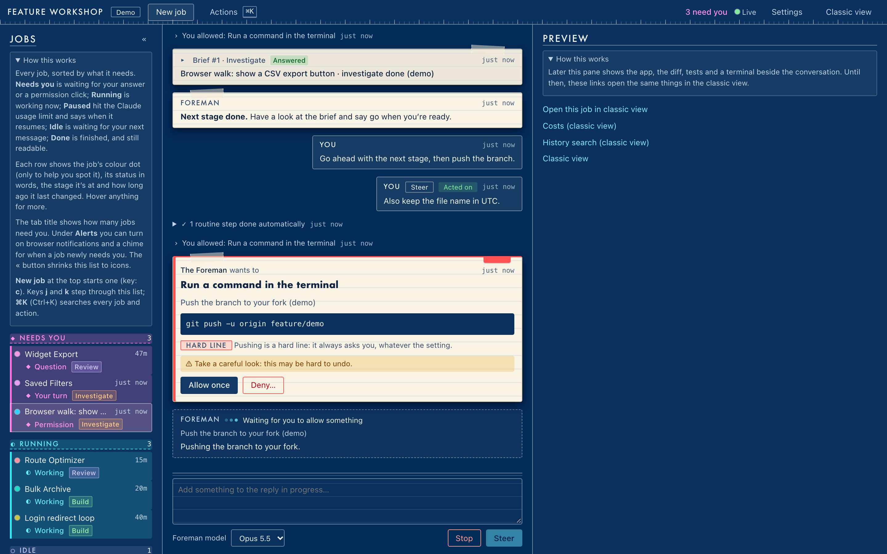 | 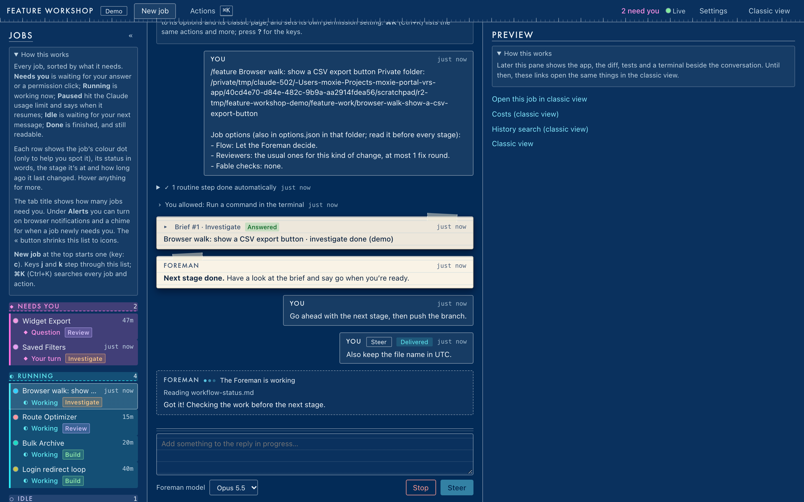 | 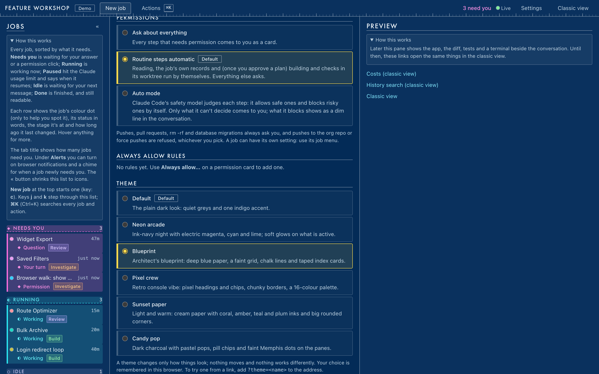 | 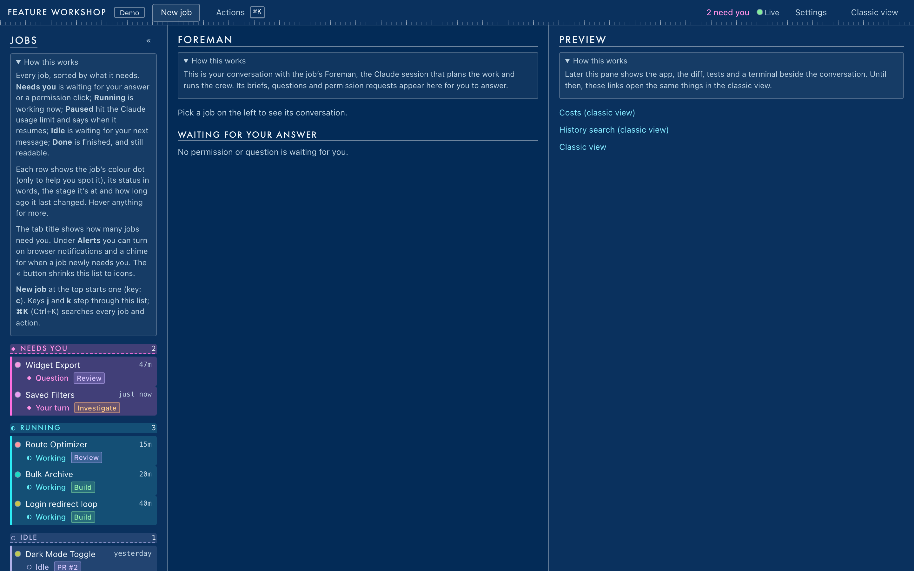 |
| 05 Permission card (hard line) | 06 Steer in progress | 07 Settings | 08 Jobs list only |

Status colour key (ask cards sit on cream paper, so their labels are dark inks):

| Token | fg | bg | line |
| --- | --- | --- | --- |
| needs-you | `oklch(.84 .19 345)` (pink) | `oklch(.8 .22 345 / .2)` | `oklch(.8 .24 345)` |
| running | `oklch(.88 .12 200)` (cyan) | `oklch(.86 .13 200 / .16)` | `oklch(.86 .14 200)` |
| paused | `oklch(.88 .15 80)` (amber) | `oklch(.87 .16 80 / .16)` | `oklch(.87 .17 80)` |
| idle | `oklch(.84 .06 285)` (lavender) | `oklch(.8 .07 285 / .14)` | `oklch(.78 .08 285)` |
| done | `oklch(.87 .15 150)` (green) | `oklch(.85 .16 150 / .16)` | `oklch(.85 .17 150)` |
| permission | `oklch(.5 .16 55)` (orange ink) | `oklch(.965 .018 85)` (`--bp-paper`) | `oklch(.74 .17 55)` |
| question | `oklch(.48 .17 300)` (violet ink) | `oklch(.965 .018 85)` (`--bp-paper`) | `oklch(.7 .16 300)` |
| hardline | `oklch(.5 .2 25)` (red ink, `--bp-red-ink`) | `oklch(.965 .018 85)` (`--bp-paper`) | `oklch(.68 .21 25)` (`--bp-red`) |
| blocked | `oklch(.78 .02 250)` (chalk grey) | transparent | `oklch(.7 .02 250)` |

## pixel-crew

The cute retro vibe of the old UI (the Game Boy clock, the pixel crew), modernised. A pixel
font on headings and chips only (Silkscreen and Pixelify Sans, bundled locally), so body text
stays readable; chunky 2px borders; 8-bit status glyphs drawn in CSS; a palette in the spirit
of a 16-colour console; a subtle dither on the panes. Playful without being hard to use. Round
2 swapped in the real pixel fonts, tinted the job rows and gave each talker its own band.

| | | | |
| --- | --- | --- | --- |
| 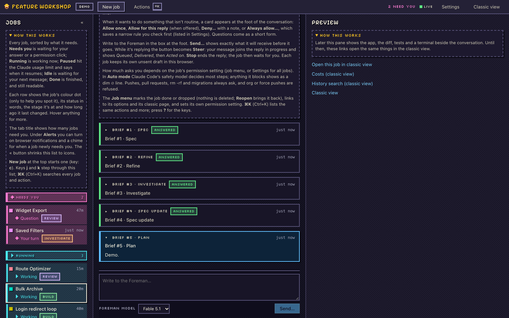 | 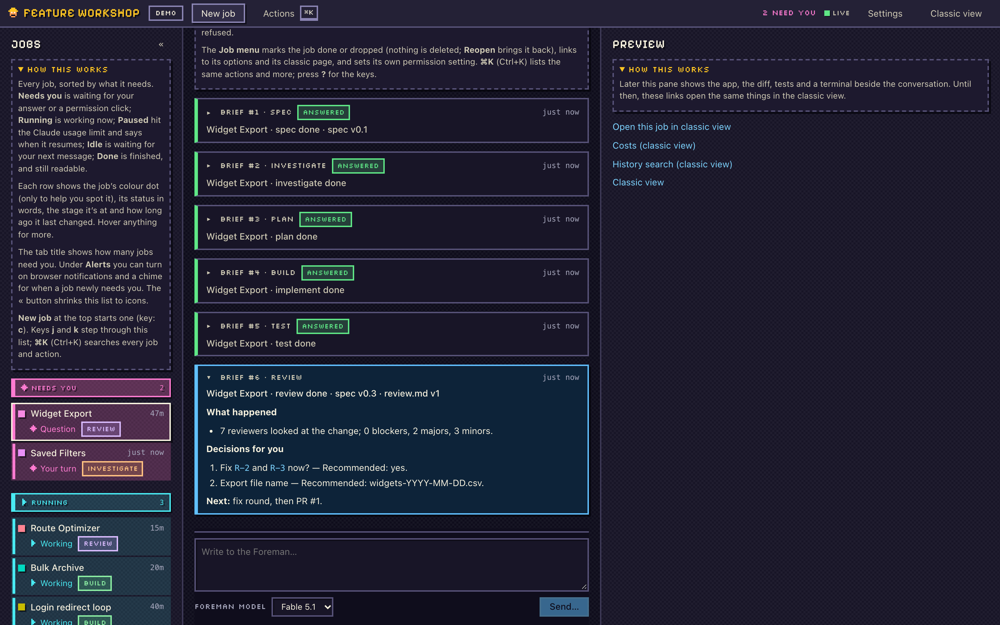 | 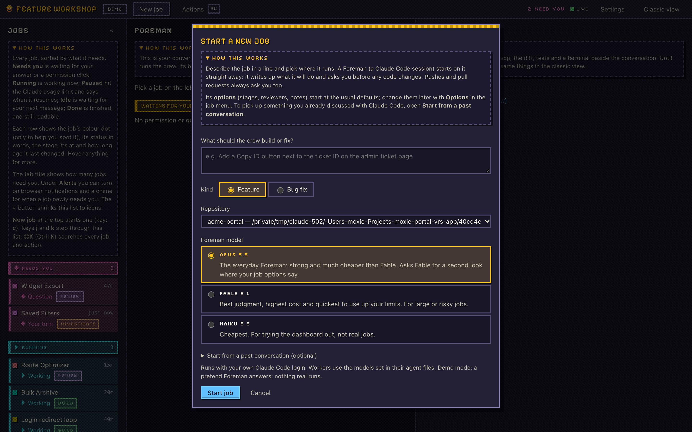 | 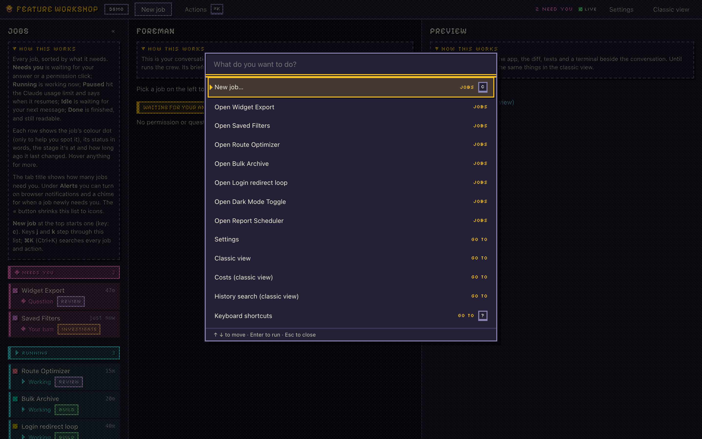 |
| 01 Shell | 02 Brief with questions | 03 New job sheet | 04 ⌘K palette |
| 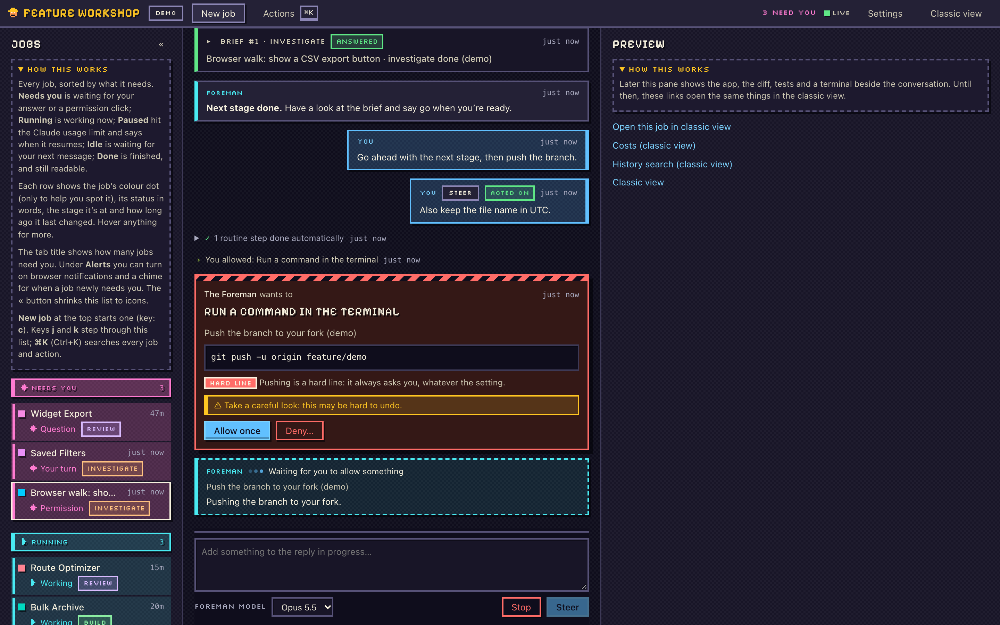 | 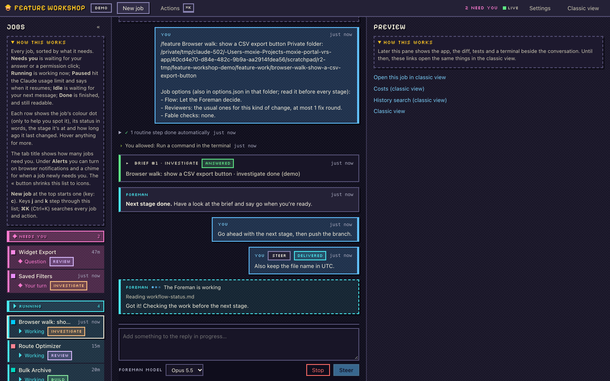 | 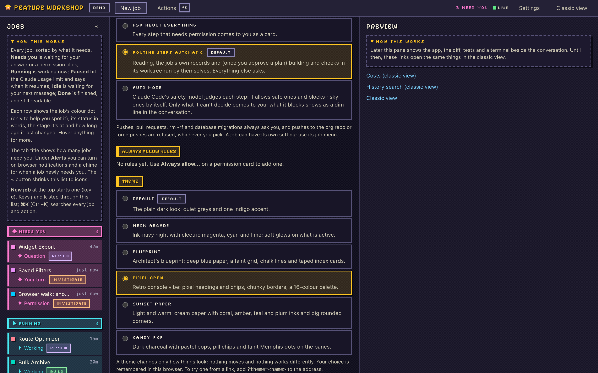 | 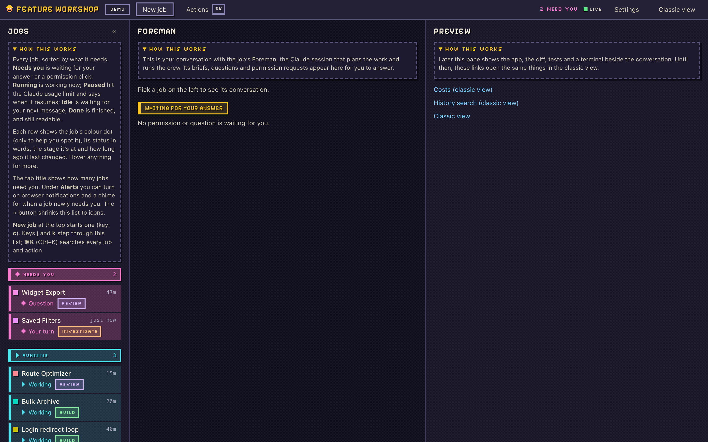 |
| 05 Permission card (hard line) | 06 Steer in progress | 07 Settings | 08 Jobs list only |

Status colour key:

| Token | fg | bg | line |
| --- | --- | --- | --- |
| needs-you | `oklch(.8 .21 350)` (pink, `--pc-pink`) | `oklch(.8 .21 350 / .2)` | `oklch(.8 .21 350)` |
| running | `oklch(.86 .13 200)` (cyan, `--pc-cyan`) | `oklch(.86 .13 200 / .14)` | `oklch(.86 .13 200)` |
| paused | `oklch(.86 .17 85)` (gold, `--pc-gold`) | `oklch(.86 .17 85 / .14)` | `oklch(.86 .17 85)` |
| idle | `oklch(.82 .07 285)` (lilac, `--pc-lilac`) | `oklch(.82 .07 285 / .12)` | `oklch(.66 .08 285)` |
| done | `oklch(.83 .18 150)` (green, `--pc-green`) | `oklch(.83 .18 150 / .14)` | `oklch(.83 .18 150)` |
| permission | `oklch(.8 .17 50)` (orange, `--pc-orange`) | `oklch(.25 .04 50)` | `oklch(.8 .17 50)` |
| question | `oklch(.8 .15 300)` (violet, `--pc-violet`) | `oklch(.25 .045 300)` | `oklch(.8 .15 300)` |
| hardline | `oklch(.86 .16 25)` (red) | `oklch(.25 .045 25)` | `oklch(.74 .2 25)` (`--pc-red`) |
| blocked | `oklch(.74 .02 280)` (slate) | `oklch(.5 .03 280 / .14)` | `oklch(.5 .03 280)` (`--pc-slate`) |

## sunset-paper

The one light theme: warm cream paper with coral, amber, teal and plum inks, big rounded
corners, bold colour blocks on the group headers and generous whitespace. Daytime-friendly and
cheerful; the inks are darker than the other themes' colours because they sit on a light page.
Round 2 rounded the headings, washed the job rows in their status colour and made the sheets
opaque.

| | | | |
| --- | --- | --- | --- |
| 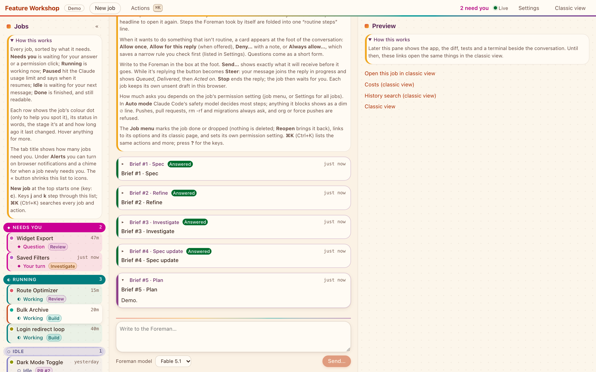 | 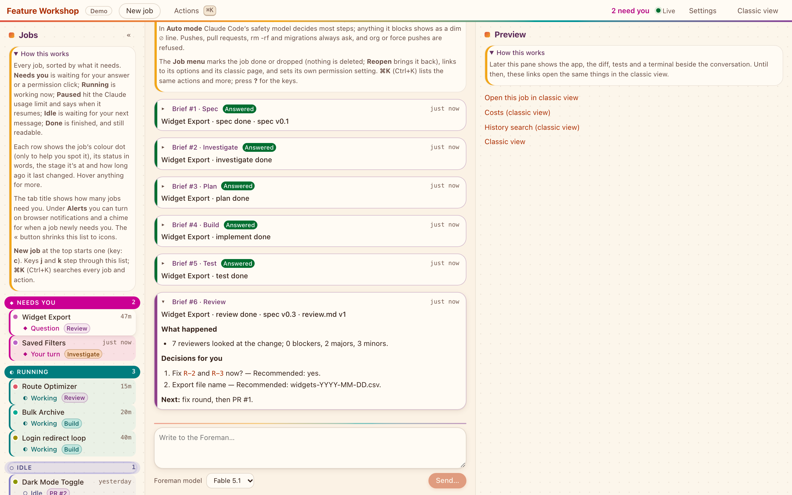 | 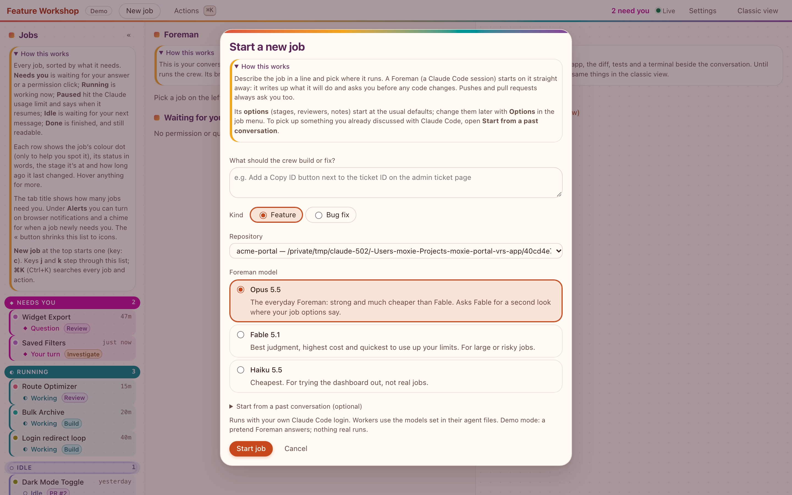 | 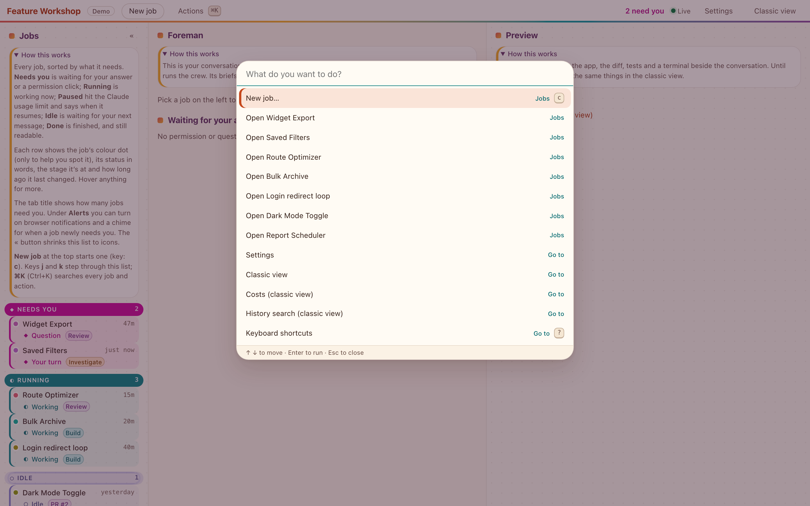 |
| 01 Shell | 02 Brief with questions | 03 New job sheet | 04 ⌘K palette |
| 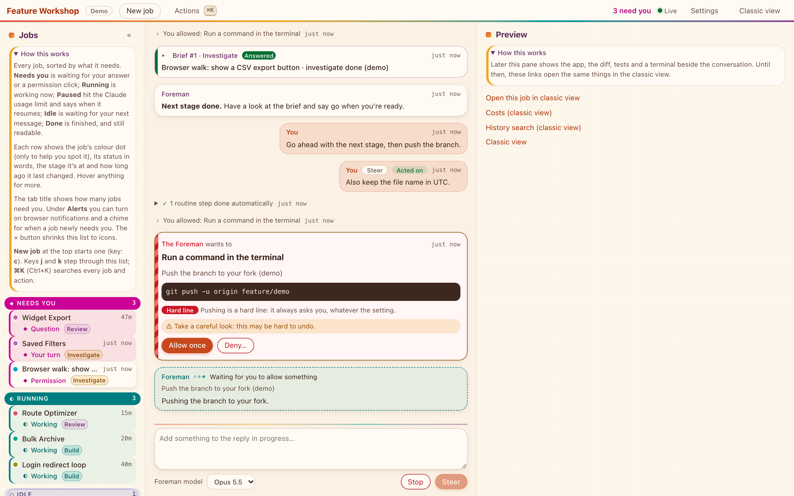 | 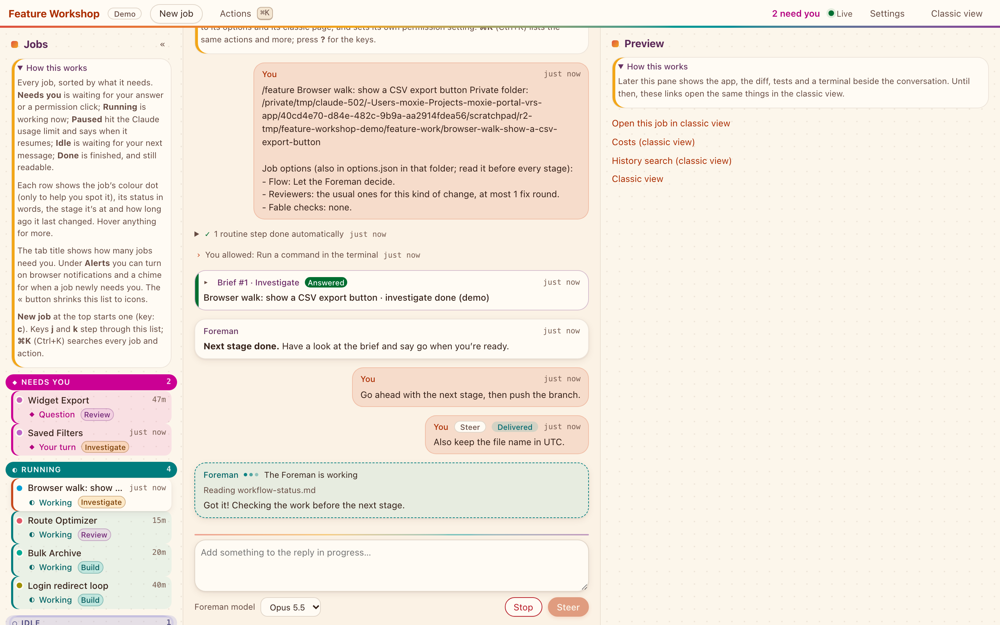 | 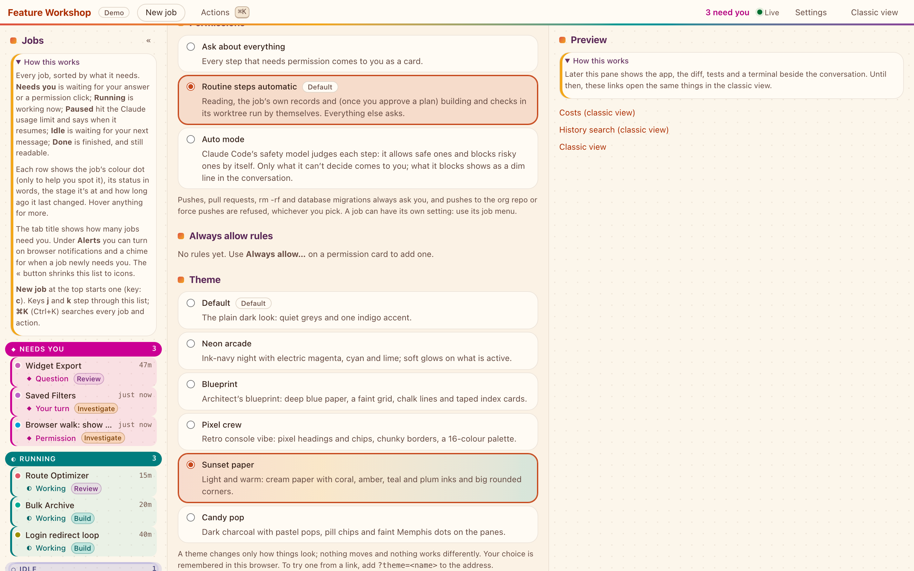 | 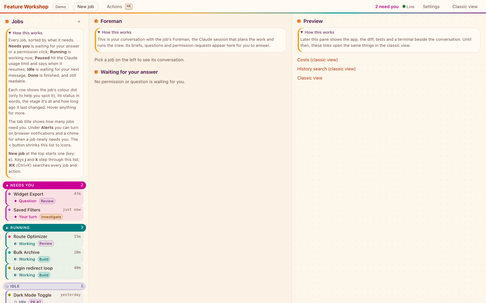 |
| 05 Permission card (hard line) | 06 Steer in progress | 07 Settings | 08 Jobs list only |

Status colour key:

| Token | fg | bg | line |
| --- | --- | --- | --- |
| needs-you | `oklch(.5 .23 345)` (magenta ink) | `oklch(.62 .24 345 / .11)` | `oklch(.56 .24 345)` |
| running | `oklch(.44 .11 195)` (teal ink) | `oklch(.65 .12 195 / .16)` | `oklch(.52 .12 195)` |
| paused | `oklch(.46 .13 65)` (amber ink) | `oklch(.8 .16 75 / .34)` | `oklch(.72 .16 70)` |
| idle | `oklch(.42 .09 285)` (plum-grey) | `oklch(.68 .1 285 / .22)` | `oklch(.62 .11 285)` |
| done | `oklch(.45 .13 150)` (green ink) | `oklch(.65 .14 150 / .16)` | `oklch(.52 .14 150)` |
| permission | `oklch(.44 .15 50)` (orange ink) | `oklch(.985 .02 70)` | `oklch(.66 .17 50)` |
| question | `oklch(.42 .17 300)` (violet ink) | `oklch(.985 .015 300)` | `oklch(.56 .17 300)` |
| hardline | `oklch(.995 .01 85)` (label text on the red chip) | `oklch(.985 .018 20)` | `oklch(.54 .21 25)` (red) |
| blocked | `oklch(.48 .02 250)` (slate) | `oklch(.5 .02 250 / .07)` | `oklch(.7 .02 250)` |

## candy-pop

Dark charcoal with saturated pastel pops: bubblegum, mint, lemon and sky. Pill-shaped chips,
rounded everything, and faint Memphis dots and squiggles in the pane backgrounds. The most
"fun" of the set while staying tidy. Round 2 lifted the pastels so small text reads, and made
the candy surfaces (sheets, palette, cards) opaque.

| | | | |
| --- | --- | --- | --- |
| 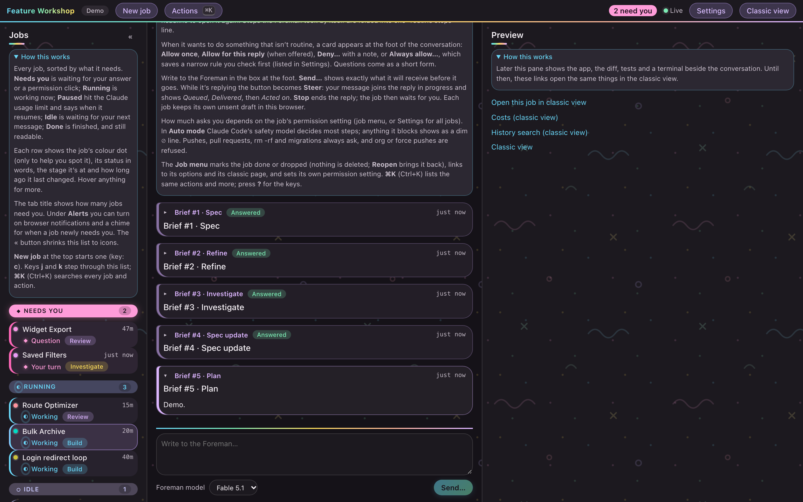 | 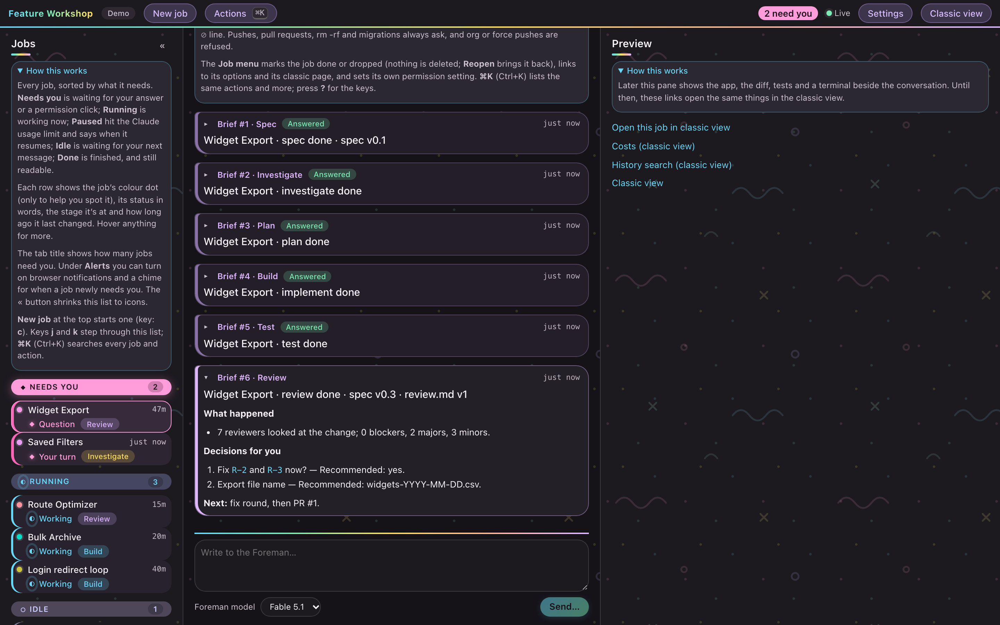 | 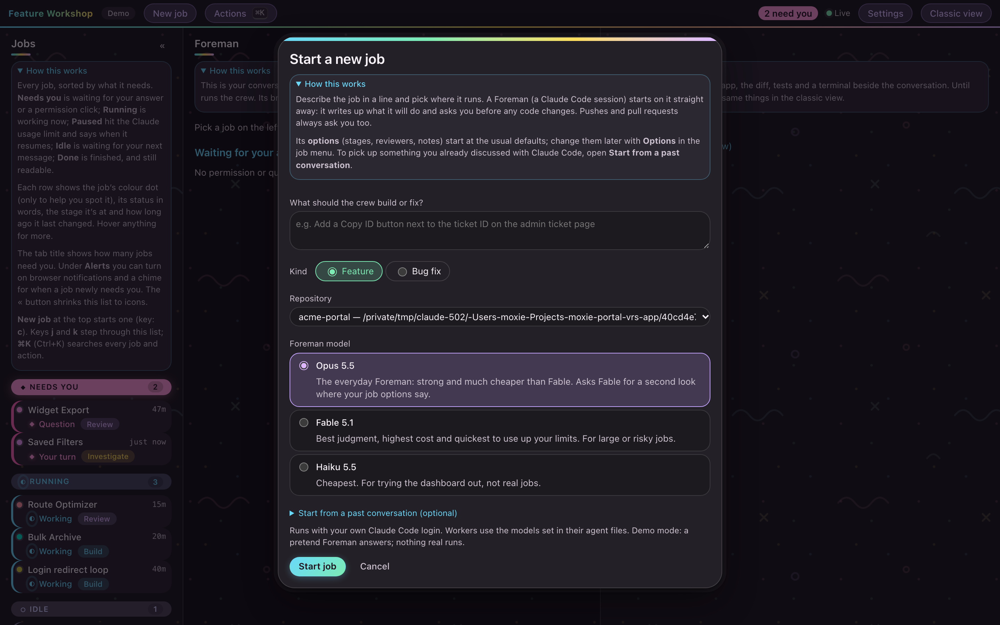 | 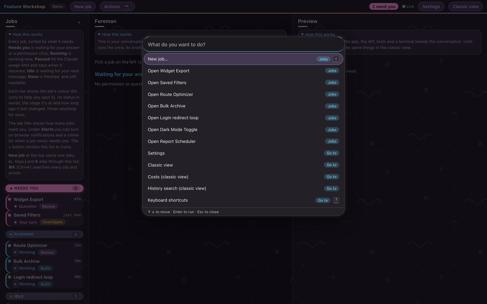 |
| 01 Shell | 02 Brief with questions | 03 New job sheet | 04 ⌘K palette |
| 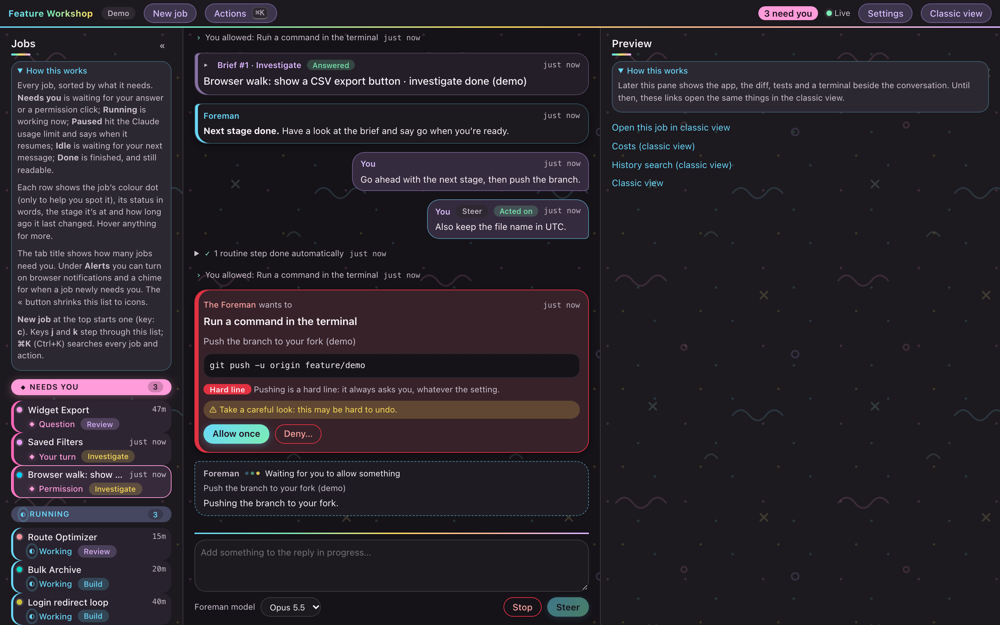 | 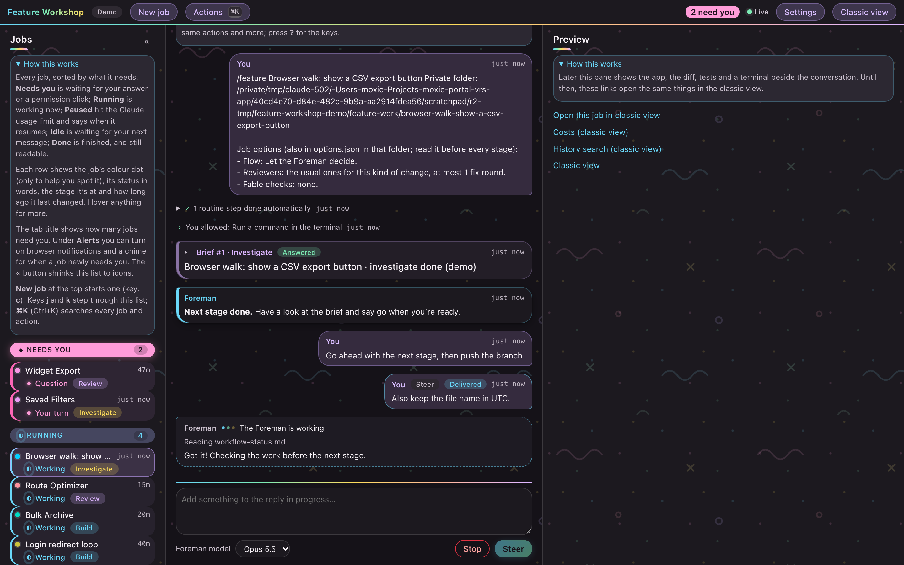 | 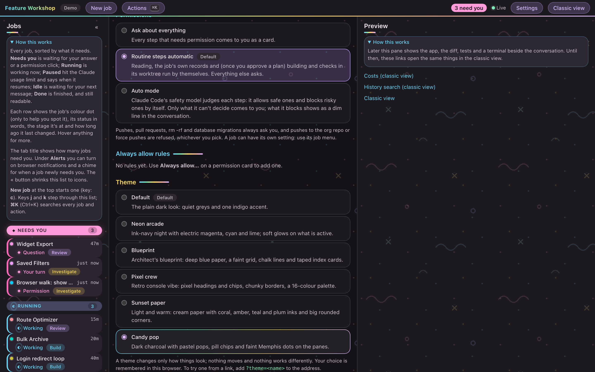 | 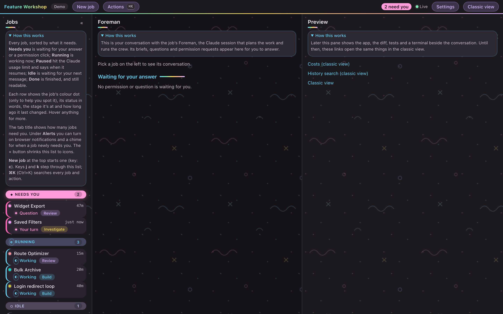 |
| 05 Permission card (hard line) | 06 Steer in progress | 07 Settings | 08 Jobs list only |

Status colour key:

| Token | fg | bg | line |
| --- | --- | --- | --- |
| needs-you | `oklch(.84 .16 350)` (bubblegum, `--candy-bubblegum`) | `oklch(.84 .16 350 / .1)` | `oklch(.72 .2 350)` (`--candy-bubblegum-deep`) |
| running | `oklch(.83 .11 220)` (sky, `--candy-sky`) | `oklch(.83 .11 220 / .2)` | `oklch(.83 .11 220)` |
| paused | `oklch(.9 .15 95)` (lemon, `--candy-lemon`) | `oklch(.9 .15 95 / .2)` | `oklch(.9 .15 95)` |
| idle | `oklch(.86 .07 285)` (lavender, `--candy-lavender`) | `oklch(.86 .07 285 / .18)` | `oklch(.86 .07 285 / .55)` |
| done | `oklch(.86 .13 160)` (mint, `--candy-mint`) | `oklch(.86 .13 160 / .2)` | `oklch(.86 .13 160)` |
| permission | `oklch(.82 .14 55)` (tangerine, `--candy-tangerine`) | `oklch(.82 .14 55 / .08)` | `oklch(.82 .14 55)` |
| question | `oklch(.84 .12 305)` (grape, `--candy-grape`) | `oklch(.84 .12 305 / .09)` | `oklch(.84 .12 305)` |
| hardline | `oklch(.83 .13 22)` (cherry, `--candy-cherry`) | `oklch(.6 .21 22 / .1)` | `oklch(.6 .21 22)` (`--candy-cherry-deep`) |
| blocked | `oklch(.79 .02 250)` (slate, `--candy-slate`) | transparent | `oklch(.79 .02 250)` |

## How these were made

`npm run web:build`, then for each theme a fresh demo (`PORT=4490 node dashboard/demo/run-demo.js`)
driven over the Chrome DevTools protocol by a script that navigates with `?theme=<id>`, walks
the eight screens, and saves PNGs. To see a theme live: open the demo and add `?theme=<id>` to
the address, or pick it in Settings.
