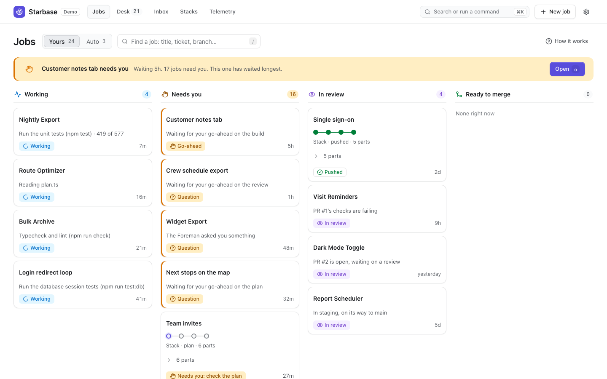

# 1. Start here

Starbase runs Claude Code's `/feature` and `/bugfix` workflows for you as **jobs**, and shows every job in one page in your browser.
You read what each job did, answer its questions and say go or no go. The work runs on your own laptop.

**The one thing to remember:** a job stops after each step and waits for you. Nothing moves on, and nothing goes to GitHub, until you say so (or until you switch a job to Auto, see [page 6](06-auto-and-permissions.md)).

## What it is

- **On your laptop**, Starbase is a small server (`dashboard/`) and a page (`web/`). The page is at http://127.0.0.1:4477/next/. It uses your own Claude Code login.
- **The team website** (optional, `hosted/`) shows a read-only copy of your jobs from anywhere. A decision you make there waits for your laptop. See [page 9](09-the-website.md).
- **The demo** (`npm run demo`) runs the whole page on made-up jobs with a pretend Foreman. Every button works and nothing real runs. It is the safest way to learn. The pictures in this guide come from it.

## The 5-minute tour

1. **Start the demo.** In the Starbase folder: `npm run demo`. If Starbase already runs on this laptop, use `PORT=4479 npm run demo` and open http://127.0.0.1:4479/next/.
2. **Jobs** (the first page). Four lanes: `Working`, `Needs you`, `In review`, `Ready to merge`. The yellow bar at the top names the job that has waited longest for you. Press `Open` (or `o`). More on [page 3](03-jobs.md).
3. **A job's page.** Seven steps across the top. When the job waits for you, the decision sits on the left and the Foreman's brief on the right. Pick your answers, then press `Go · all recommended` or `Send back`. More on [pages 4](04-a-job.md) and [5](05-deciding.md).
4. **The Desk** (`Desk` in the top bar). Every decision from every job, one at a time, oldest first. `a` is go, `r` is send back.
5. **⌘K** (Ctrl+K on Windows and Linux). Search for any job, page, setting or action. `?` lists every key ([page 10](10-keys-and-command-box.md)).
6. **New job** (top right, or `c`). Describe the job in a line, pick the repository, Feature or Bug fix, the level and the Foreman's model, then start it.

## The words

| Word | What it means |
|---|---|
| **Job** | One piece of work: a feature or a bug fix, with its own folder, branch and worktree. |
| **Foreman** | The Claude session that runs the job (the `/feature` or `/bugfix` conductor). You talk to it. |
| **Crew** | The worker agents the Foreman hands each stage to: Scribe writes the spec, Sleuth investigates, Draftsman plans, Builder builds, Tester checks, and the reviewers (Head inspector, Locksmith, Gauge, Stickler, Fuse, Mason, Stopwatch, Painter). |
| **Brief** | What the Foreman writes at the end of a step: what happened, what it decided, and what it needs from you. Numbered: `Brief #6`. |
| **Gate, go-ahead, decision** | The point where a job waits for you. A go-ahead is "may I go on to the next step?"; the Foreman may add questions with options. You answer with `Go` or `Send back`. |
| **Permission** | A crew member wants to run something that needs your yes (a command, a push). You answer `Allow once`, `Deny`, or one of the other buttons. |
| **Step (stop)** | The seven steps every job shows: Spec, Investigate, Plan, Build, Test, Review, Ship. The workflow's own stages fold into them (for example Clarify and Screens are part of Spec; PR #1, PR #2, Staging QA and PR #3 are Ship). Older screens say "stop" for the same thing. |
| **Level** | How much process a job gets: L0 Tweak, L1 Small, L2 Standard, L3 Large. The table is in the [README](../../README.md#how-a-job-runs). |
| **Auto** | A switch on a job: an approver answers for you up to PR #1. Not the same as **Auto mode**, a permission setting. Both are on [page 6](06-auto-and-permissions.md). |
| **Stack** | A big ticket split into parts that are built side by side and merged one after another. |
| **PR #1, #2, #3** | The three pull requests a job goes through: PR #1 from your fork into the same-named org branch, PR #2 from the org branch into staging, PR #3 from staging into main. See [page 7](07-shipping.md). |

The full list is in the [glossary](12-glossary.md).

## Where to go next

- New to the laptop side: [2. Install and run](02-install-and-run.md).
- Ready to work a job: [4. A job](04-a-job.md), then [5. Answering a decision fast](05-deciding.md).
