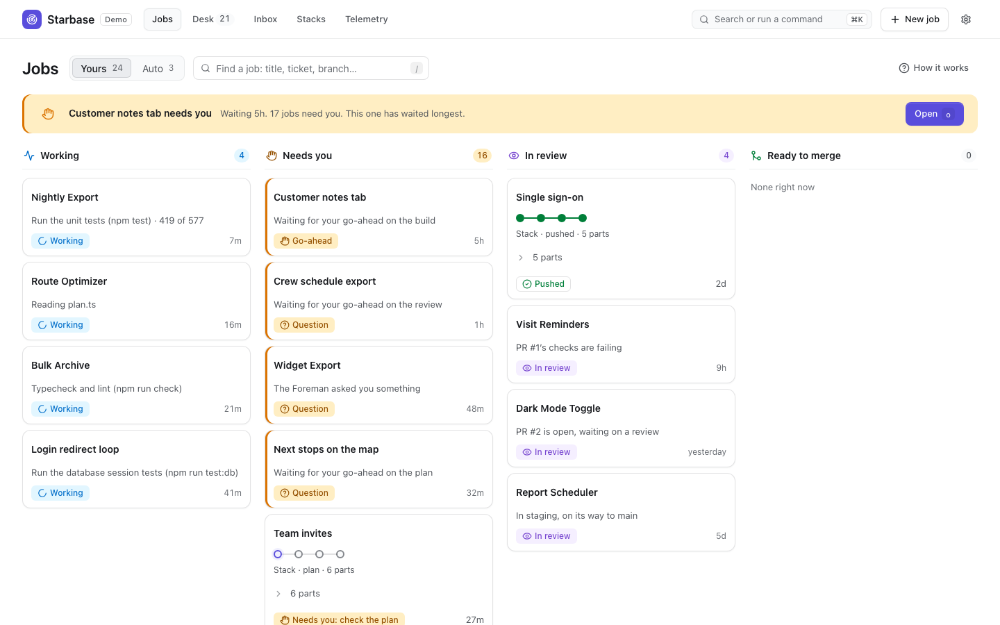
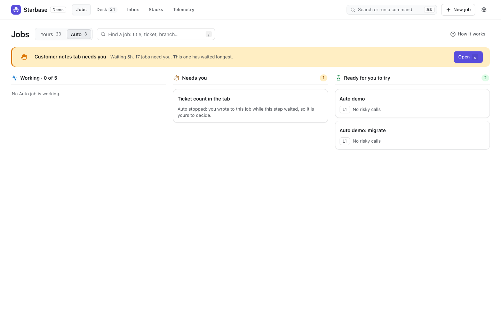
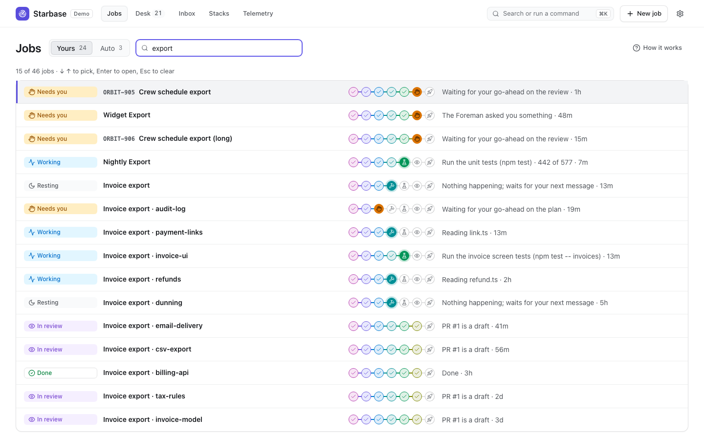
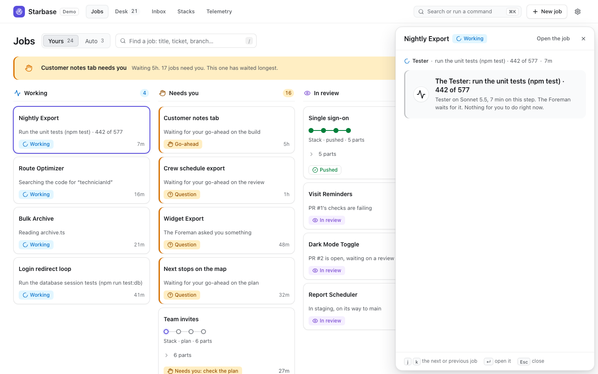

# 3. The Jobs page

Jobs is the first page: every job you have, in four lanes, with the one job that needs you most named at the top.
You come here to see what is moving and to pick the next thing to look at.

**The one thing to remember:** the yellow bar at the top is your next move. `Open` (or `o`) takes you to the job that has waited longest for you.

## The parts of the page

### The two tabs: `Yours` and `Auto`

- **`Yours`** has every job except the ones Auto is running. The number beside it is the count.
- **`Auto`** has the jobs that run with the Auto switch on, in three groups: `Working · n of 5` (how many of Auto's places are in use), `Needs you` (Auto stopped, with the reason, or the job was set aside as too big) and `Ready for you to try` (PR #1 is open). Auto is explained on [page 6](06-auto-and-permissions.md).
- Starbase remembers which tab you had open.

### The next-step bar

The bar under the tabs names the next job that needs you and why, for example "Customer notes tab needs you · Waiting 5h. 17 jobs need you. This one has waited longest." It takes jobs from `Yours` first, then from Auto's `Needs you`. `Open` (key `o`) opens that job.

### The four lanes

| Lane | What is in it |
|---|---|
| `Working` | The Foreman or a crew member is busy. The card says what it is doing now (for example "Run the unit tests (npm test) · 419 of 577") and for how long. |
| `Needs you` | The job waits for you: a go-ahead, a question or a permission. The chip says which (`Go-ahead`, `Question`, …). |
| `In review` | A pull request is open and waits on a review or its checks. |
| `Ready to merge` | A pull request is approved, usually with its checks passed. |

Jobs that rest (nothing happening; they wait for your next message) and jobs that are done fold under the board. A stack shows as one card with its parts folded inside it.

A card that changes lane waits until your pointer leaves the board, so nothing moves under your hand.

### Find a job: the search box

Press `/` anywhere on Jobs, or click the box that says "Find a job: title, ticket, branch…". Type a few letters.

- The board is replaced by every job that matches, from both tabs, resting and done ones too, best first. The line above the list says how many match ("15 of 46 jobs").
- `↓` `↑` pick a job, `Enter` opens it, `Esc` clears the box (a second `Esc` leaves it).
- Nothing is fetched: it searches the jobs the page already has.

### The quick look

Click a card (not a link or a button on it), or press `Space` on it, to see a job without leaving Jobs. A panel opens on the right with what the job is doing now and its next step, with Go and No go when it waits for you.

- `j` and `k` move to the next or previous job, `Enter` opens the whole job, `Esc` closes the panel.
- The list behind does not move.
- The address carries the open quick look (`#/?peek=<job>`), so a reload brings it back.

## Other ways to see the same jobs

- **Settings → Look → Jobs layout:** `Four lanes` (the default), `One list` (every job in one list, its lane in words), or `Station` (a 3D deck, only with Play set to Full; see [page 8](08-other-pages.md#crew-dex-and-play)).
- **The gear menu** (top right) has `Flow map` (where each job's work is on its way: worktree, fork, branch, staging, main) and `Table` (the jobs as rows you can sort and filter).
- On a phone the lanes become folded sections, `Needs you` open first.

## Keys on this page

| Key | What it does |
|---|---|
| `/` | Find a job |
| `o` | Open the job the next-step bar names |
| `j` / `k` | Open the next or previous job (in the Jobs list's order) |
| `c` | Start a new job |
| `u` | Check GitHub now |

The full list is on [page 10](10-keys-and-command-box.md).

## Next

[4. A job](04-a-job.md).
