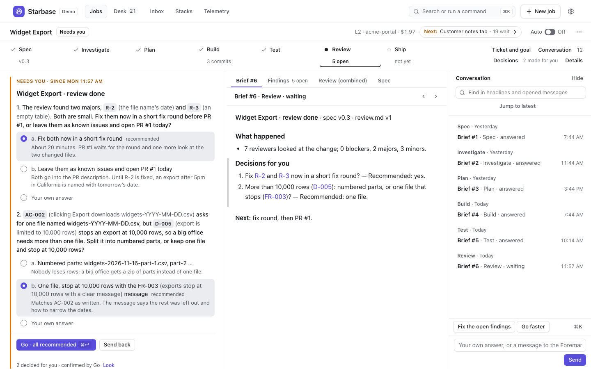
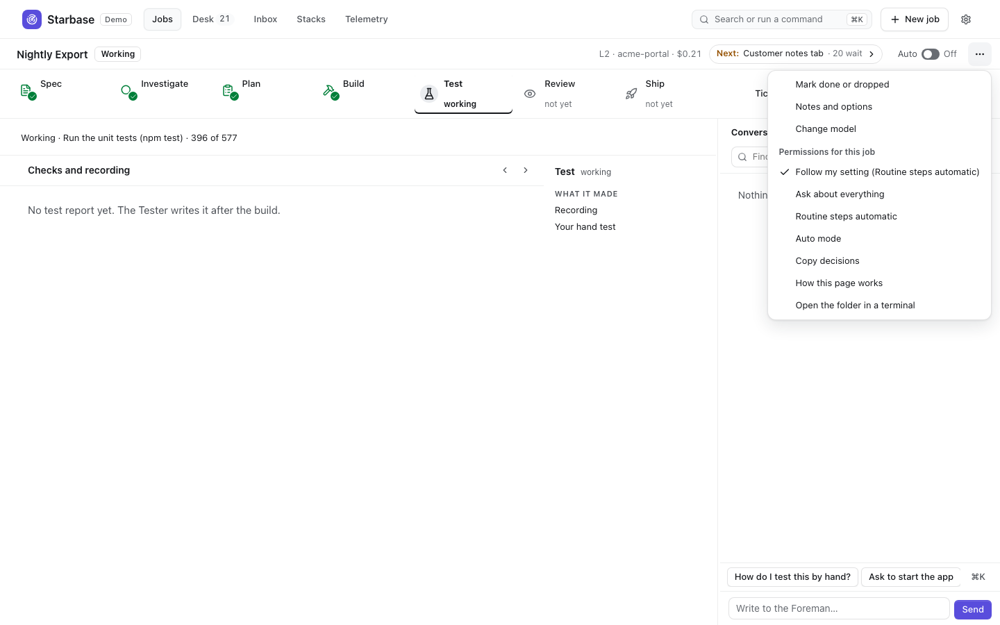
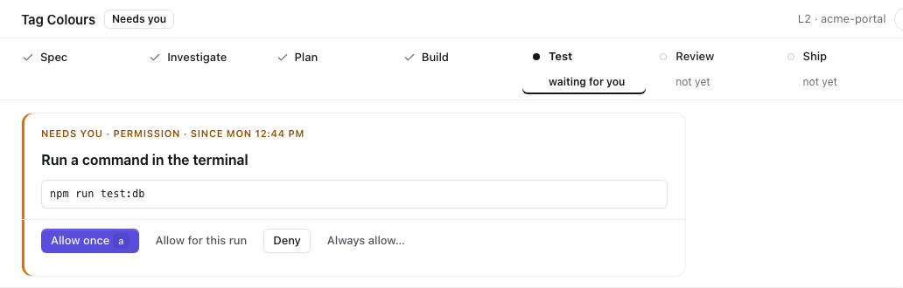
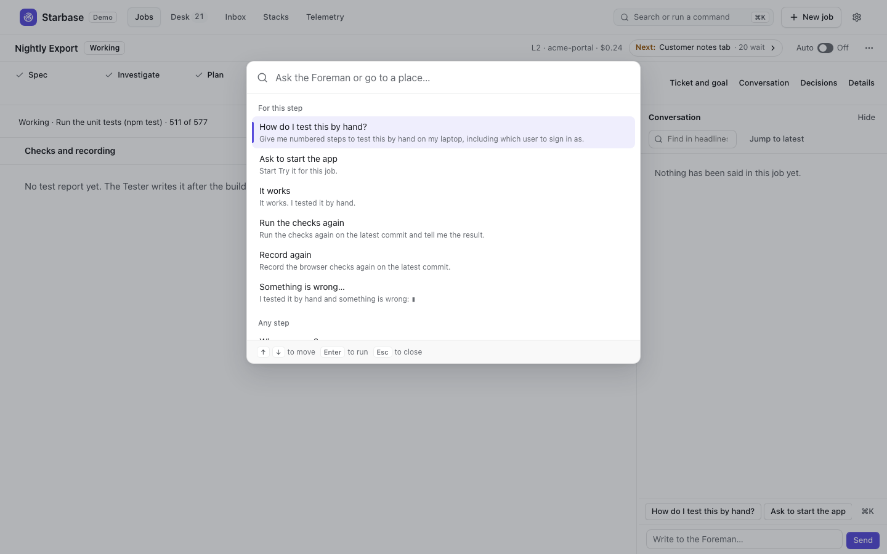

# 4. A job

A job's page answers three questions: does it need me, where is it, and what did it do.

**The one thing to remember:** when the job waits for you, your decision is on the left and the Foreman's brief is beside it. Everything else (the steps, the conversation, the details) is one click away and never moves under you.

## The page from top to bottom (laptop, 1100 px and wider)

### 1. The header row

From left to right:

- **The ticket key** (when the job came from an Orbit ticket; it links to the ticket), **the title**, and **one state word**: `Needs you`, `Working`, `Waiting on GitHub`, `Paused` or `Done`.
- **Dim facts:** the level (`L2`), the repository, and the cost so far (shown once it is over 10 cents).
- **`Next: <job> · n wait ›`**: the job that has waited longest for you, other than this one. One click, or `g` then `n`, opens it. This is how you work through a queue without going back to Jobs.
- **The Auto switch** with its word (`On` or `Off`). See [page 6](06-auto-and-permissions.md).
- **The `⋯` menu** ("More for this job") with everything rare:

| Item | What it does |
|---|---|
| `Mark done or dropped` | Moves the job to Done, as done or dropped, with a note if you like. Nothing is deleted; you can reopen it. Not while the Foreman is replying. |
| `Reopen` / `Keep it open` | On a job marked done or dropped. |
| `Notes and options` | The job's notes (`notes.md`, read by the Foreman every session) and its options: level, stages, reviewers, testing, Fable second looks and models. |
| `Change model` | The Foreman's model is fixed for a job; another model starts the job again from step one. You see what that moves before you agree. |
| `Permissions for this job` | `Follow my setting`, or one of the three permission settings for this job only. See [page 6](06-auto-and-permissions.md). |
| `Copy decisions` | Copies the product decisions as a plain list, to paste into the ticket. |
| `How this page works` | The page's three guide cards. |
| `Open the folder in a terminal` | Opens a terminal in the job's worktree. |

### 2. The steps row

The seven steps run across the page: Spec, Investigate, Plan, Build, Test, Review, Ship. Each cell has a mark (✓ done, ● now, ○ not yet, – skipped) and one result word under its name: a version (`v0.3`), a count (`3 commits`, `14 passed`, `5 open`), `working`, `waiting for you` or `not yet`.

- Click a step (or press `[` and `]`) to pick it. The reader shows its main output and the step panel lists everything it made.
- The current step and the picked step are both marked.

At the right end of the row are the job's four links:

| Link | Opens |
|---|---|
| `Ticket and goal` | The ticket and what the job is for. `g` then `t`. |
| `Conversation` (with its count) | The conversation column. `g` then `c`. |
| `Decisions` (with "n made for you") | Every decision on the job, including the ones the Foreman or Auto made for you. |
| `Details` | One table: each step, who worked it, the task it was given, how long, how it ended. |

### 3. When a decision waits: the decision and its brief side by side

When the job waits for a go-ahead or an answer, the page splits in two under the steps:

- **Left: Your move.** "NEEDS YOU · SINCE …", the headline, each question with its options, then `Go · all recommended` and `Send back`. How to answer fast is on [page 5](05-deciding.md).
- **Right: the reader**, opened on the brief. Tabs above it switch between what the decision is about: the brief (`Brief #6`), what the step made (for example `Findings 5 open` at a review, or `PR lines` at Ship), and the `Spec`.

A permission (a command that needs your yes) takes the same place on the left, with the exact command:

### 4. When nothing waits: the reader and the step panel

- **The reader** shows one thing at a time: a brief, a document (spec, plan, findings, test plan), the changes (commits, files and the diff), the checks and recording, the PR lines, a message. Its title row says what it is, its version, its step and when; `‹` `›` step to the previous and next thing; `Older` lists older versions and earlier rounds. Lines stop at about 80 characters so they stay easy to read.
- **The step panel** ("What it made") beside the reader: the picked step's name and result, how long it took (or since when it runs), and every output as a row that opens in the reader.
- A line above the reader says what the job is doing now, for example "Working · Run the unit tests (npm test) · 465 of 577".

### 5. The conversation column

On the right, always there: every message, brief and answer, one line each, grouped by step and day ("Review · Today").

- Click a line to open it in place; click again to fold it. `Open all in this step` opens a whole step.
- Small events (notes, your permission answers, routine steps) fold into "n small events".
- The box at the top filters the lines as you type. `/` puts the cursor there. `Jump to latest` goes to the end and says how many are new.
- A new message adds a line at the end and never pulls the page away from what you are reading.
- `Hide` hides the column; its message box stays along the foot. The `Conversation` link brings it back. Starbase remembers this in your browser.

At the foot of the column:

- **The asks row**: up to four one-click requests that fit the open step (see below).
- **The message box**: write to the Foreman. See [page 5](05-deciding.md#the-message-box).

### Drag handles

Two columns can be resized by dragging the thin handle at their edge: the decision (while one waits) and the conversation. With the handle focused, the arrow keys move it by 24 px (with Shift, 96 px); a double click, or `Home`, gives back the default. The widths are kept in this browser.

## The ids in a decision explain themselves

Decisions often name requirement ids such as `R-2`, `FR-003` or `AC-002`. On the job page:

- every id the page knows is followed by its meaning in brackets, for example `R-2 (the file name's date)`;
- in a question, the id is a button: it opens the id's words under the question, with `Open in Findings` (or wherever it lives); a second click, or `Close`, folds it. The decision stays where it is.

## The asks row and ⌘K: everyday requests in one click

The asks are the requests people type again and again. Hover over one to see the exact words it sends: there are no hidden prompts.

- An ask with nothing to fill in sends at once and shows `Sent · Undo` for four seconds. `Undo` takes it back before it leaves.
- An ask that ends with "…" (for example `Drop something…`) puts its words in the message box with the cursor in the gap. Nothing is sent until you press `Send`.
- `Go faster` is not a message: it switches the job to one reviewer a round and no second looks, from the next step, and says what it changed (with `Undo`).
- `⌘K` on the job page lists every ask, grouped `For this step`, `Any step`, `Yours` (messages you kept with `Keep as an ask`), places on the page (`Go to: Plan`…) and other steps. Its last row, `Every Starbase action`, opens the app's full command box.

The asks in the code (`web/src/jobpage/asks.ts`), by step:

| Step | In the row | Only in ⌘K |
|---|---|---|
| Any step | `Where are we?`, `Explain this step`, `Go faster` | `Stop here`, `Make this the rule next time…` |
| Spec, Investigate, Plan | `Summarise for approval`, `Drop something…`, `Go faster` | `Reuse what exists` |
| Build | `Where are we?`, `Go faster` | |
| Test | `How do I test this by hand?`, `Ask to start the app`, `It works`, `Run the checks again` | `Record again`, `Something is wrong…` |
| Review | `Fix the open findings`, `Go faster` | `Publish the walkthrough` |
| Ship | `Pull PR comments`, `Shorten the PR text`, `Mark done` | `Test steps for stakeholders`, `Fix the ticket number…`, `New branch with only this change` |

While the Ship step is not the open step, the PR's next action (for example `Push and open PR #1`) leads the row.

## Point at something, then say what to change (notes)

You can point at any block in the reader (a plan step, a spec line, a diff line, a finding, a check, a paragraph of a message) and leave a note on it.

1. Hover the block: a `+` shows in its left margin. Click it, select some text in the block, or press `n` with the pointer on it.
2. A small box opens under the block with `Change`, `Drop this` and `Explain`.
   - `Change` and `Drop this` add a note to the message box as a chip. Nothing is sent yet.
   - `Explain` asks the Foreman at once; its answer opens beside the block. It changes nothing.
3. The buttons then say what they carry: `Send · 3 notes`, `Send back · 3 notes`, `Go · and do these 3`. `Show what will be sent` shows the exact text.
4. When the Foreman comes back, Your move shows `What you asked · the Foreman says 3 of 3 done`, one line per note. A click opens that exact change. A note not done has `Ask again`.

Chips survive a reload. Click a chip to jump to its place; `×` removes it.

### Pictures and pins

- Click on a frame of a recording (in the Test step's checks) to drop a numbered pin there with a box; write what is wrong and press `Add the note`.
- Paste a screenshot into the message box (⌘V). Starbase keeps it in the job's own folder on the laptop and opens it in the reader so you can pin on it.

## Narrow windows and phones

- **760 to 1100 px:** the job's column takes the width. Opening something slides the reader over it with `Back to the job`.
- **760 px and under:** three screens, each with its own address: the job (header, Your move, steps, rows, the message box at the bottom), a step, and the reader. Back walks the screens.

## Addresses

Every view has an address, so Back and a reload return to it:

| Address | Shows |
|---|---|
| `#/job/<job>` | The job |
| `#/job/<job>/stage/<step>` | The job with that step picked (`spec`, `investigate`, `plan`, `build`, `test`, `review`, `ship`) |
| `#/job/<job>/conversation`, `#/job/<job>/overview` | The conversation, or the ticket and goal |
| `#/job/<job>/id/<id>` | The job (a requirement id linked from a reply or a brief) |
| `#/job/<job>/read/<kind>/<id>` | One thing in the reader |
| `#/job/<job>/screens` | The job's wireframes, full width |

## Next

[5. Answering a decision fast](05-deciding.md).
