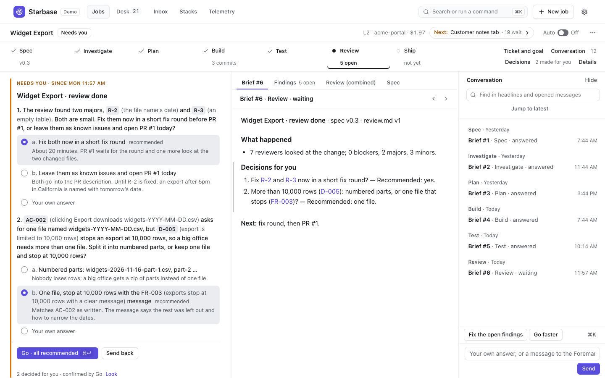
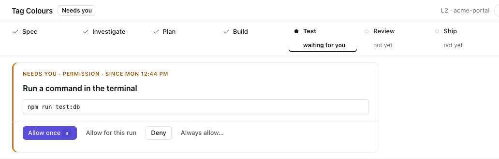
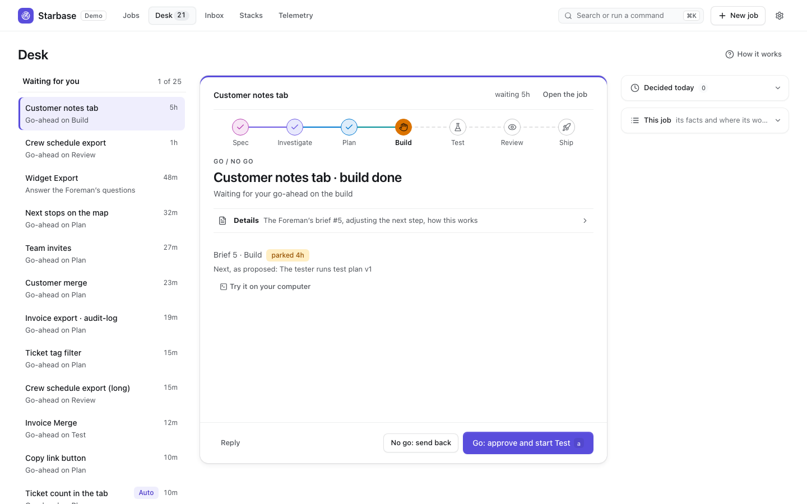

# 5. Answering a decision fast

Most of your time in Starbase is spent saying yes, no, or "change this". This page shows the quickest way to do each, on the new job page and on the Desk.

**The one thing to remember:** the Foreman's recommended answers are already picked. If you agree, one press of `⌘↵` (Ctrl+Enter) or `a` is Go. If you don't, write what to change in the message box and press `r` for Send back.

## A go-ahead (the end of a step)

Your move shows the step's headline, then each of the Foreman's questions with its options.

- **The recommended option is already picked** (it says `recommended`), so Go is ready at once.
- **The Go button says what it carries:** `Go · all recommended`, or `Go · 1 changed` after you pick something else. With no questions it names the next step, for example `Go · open PR #2`.
- **`Your own answer`** is the last option under each question: a one-line field for an answer the Foreman did not offer.
- **"n decided for you · confirmed by Go"** counts the smaller calls the Foreman made on its own. `Look` opens them. Pressing Go confirms them too.

### Go

- Click `Go · …`, press `⌘↵` (Ctrl+Enter) from anywhere on the page, even from inside the message box, or press `a`.
- Words in the message box go with the Go, as a note on the approval.
- The button shows `Sent` at once. It sends once, however fast you click. If Starbase refuses (for example the spec or plan changed since the card was shown), your picks and your words come back, with the reason in plain words.

### Send back

- Write what to change in the message box, then click `Send back` or press `r`. The words are the change.
- With an empty box, `r` puts the cursor in the box for you.
- With notes collected (see [page 4](04-a-job.md#point-at-something-then-say-what-to-change-notes)), the buttons read `Send back · 3 notes` and `Go · and do these 3`.

### Keys while a decision waits

| Key | What it does |
|---|---|
| `⌘↵` / Ctrl+Enter | Go: send the picks shown |
| `a` | Go (or `Allow once` for a permission). Never for a hard line or a risky step. |
| `r` | Send back: the words in the message box are the change |
| `↓` `↑` | Move between the options |
| `Space` | Pick the option you moved to |
| `c` or `i` | Put the cursor in the message box |

## A question with no options

When the Foreman asks something open, the replies it suggested in quotes show as quick replies. A click fills the message box; nothing is sent until you press `Send`.

## A permission

A crew member wants to run something that needs your yes. Your move shows what it wants and the exact command.

| Button | What it does |
|---|---|
| `Allow once` (`a`) | Yes, this one time. |
| `Allow for this run` | Lets this kind of step run without asking again until this reply finishes. Nothing is saved. Shown only where Claude Code offers it. |
| `Deny` | No. The crew skips it and carries on. You can say why. |
| `Always allow…` | Saves a rule so steps like this run without asking, in every job. You choose how narrow it is and confirm it first. Rules are listed in Settings → Rules. |

A **hard line** (a push, a pull request, `rm -rf`, a database change, a merge) or a step Claude Code flags as risky has no key and no `Always allow…`: you click `Allow once` yourself each time. See [page 6](06-auto-and-permissions.md#hard-lines).

## The message box

There is one place to write, and what the words do depends on the button you press:

| You press | The words become |
|---|---|
| `Go · …` | the note on your approval |
| `Send back` | the change you ask for |
| `Send` | a message to the Foreman |

- **Your draft is kept** per job, in this browser: through a reload, a step pick, a permission card or a narrower window.
- **While the Foreman is replying**, the box says "Sends when it finishes". Press `Send` and your message waits: it shows under the box with `Cancel`, and goes as soon as the reply ends. Only one message can wait per job; a second one asks whether to `Replace it`.
- **`Stop it and send now`** stops the reply in progress and sends your words as it ends.
- If a send is refused (the usage limit, or Claude Code is open on this job in a terminal), your words go back in the box with the reason.

## Stop

The new page has no separate Stop button. To stop a job:

- **Stop the reply now:** `⌘K`, then `Every Starbase action`, then `Stop the reply`. It ends the Foreman's reply at once; anything waiting for your answer is declined, your draft is kept, and the job waits for your next message.
- **Stop and send something instead:** `Stop it and send now` beside the message box.
- **Stop after this step:** the `Stop here` ask in `⌘K` sends "Stop after the current step and wait for me."

On the old job page the message box's button turns into `Stop` while the Foreman replies.

## The Desk: every decision, one at a time

The Desk (`Desk` in the top bar, or `g` then `d`) lists every decision waiting in every job, oldest first. The count is on the top bar.

- The left column is the queue. The middle is the decision: the job's seven steps, the headline, `Details` (the Foreman's brief), and `Reply`, `No go: send back` and `Go: …`.
- After you decide, the next one opens.

| Key | What it does |
|---|---|
| `j` / `k` (or `↓` `↑` in the queue) | Next or previous decision |
| `a` | Approve, or `Allow once`. Never for a hard line, a risky step or a question. |
| `r` | No go: send back (say what to change) |
| `c` | Reply without deciding |
| `d` | Deny a permission |
| `b` | Show or hide the brief |
| `o` | Open the job |

Settings → Look → Desk layout switches between `One at a time` (the default; the whole queue opens in a drawer) and `Three columns` (the queue, the decision and Decided today side by side).

## Next

[6. Auto mode and permissions](06-auto-and-permissions.md).
