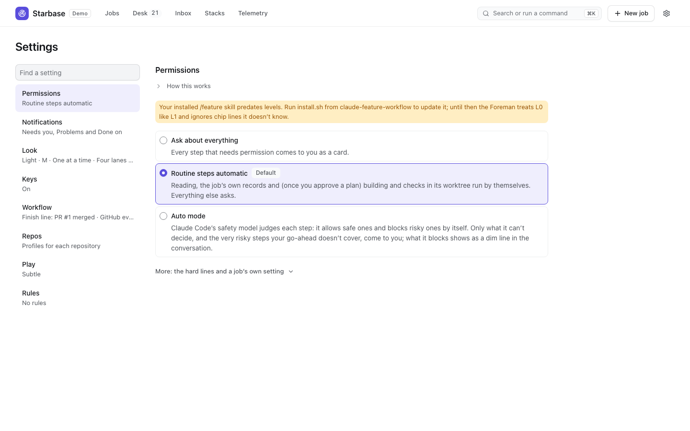

# 6. Auto, Auto mode and permissions

Three settings decide how often a job stops to ask you: the **permission setting**, the **hard lines** (which no setting can turn off), and the per-job **Auto** switch.
Auto and Auto mode sound alike but are different things; this page keeps them apart.

**The one thing to remember:** whatever you pick, a few things always ask you (merges and database changes) and a few are always refused (force pushes and pushes to the org repository). Auto never merges.

## The permission setting

Set it for every job in **Settings → Permissions**, or for one job in the job's `⋯` menu under `Permissions for this job` (it applies at once, even to a reply in progress).

| Setting | What happens |
|---|---|
| `Ask about everything` | Every step that needs permission comes to you as a card. Slowest, and you see everything. |
| `Routine steps automatic` (the default) | Reading, the job's own records and (once you approve a plan) building and checks in its worktree run by themselves. Everything else asks. Starbase's own list decides what counts as routine. |
| `Auto mode` | Claude Code's safety model judges each step: it allows safe ones and blocks risky ones by itself. Only what it can't decide, and the very risky steps your go-ahead doesn't cover, come to you. What it blocks shows as a dim line in the conversation. It uses a little of your Claude usage on each step it judges. |

`Auto mode` can't be picked when Claude Code says it isn't available for your account; the menu then says why.

## Hard lines

Hard lines are commands that always come to you as a card, whatever the setting, and a few that Starbase refuses outright. They are checked twice: by a hook in every Foreman session (before Claude Code's own permission check) and again when the request reaches Starbase. A saved `Always allow…` rule can't let one through. The list is in `dashboard/lib/hard-lines.js`.

**Always ask (a card):**

- `git push` (any push; the remote and branch are on the card)
- `gh pr create` (opening a pull request)
- `gh pr merge` (merging one)
- `rm -rf` and the other forms of a recursive, forced delete
- database changes: package scripts named `db:*` or `*migrat*`, and the usual migration tools (not scripts that only read, such as `db:status`)

**Always refused, in every setting:**

- pushes to the org repository (the `moxie` remote, a `github.com/moxie…` address, or any remote whose push address is one; plus each registered repository's own org)
- force pushes (`--force`, `-f`, `--force-with-lease`, a `+` refspec, `--mirror`, …)
- `gh api` writes to the org repository's branches, except creating a new branch from a written-out commit (never main, staging or a release branch)

### The go-ahead

Only in `Auto mode`, your go-ahead at the PR step already covers two hard lines, so they don't ask again:

- `git push` and `gh pr create`, once you have approved the PR stage (the job is at PR #1 or later). `gh pr create` is covered only into the job's own branch, from it, with no reviewer.
- `rm -rf`, when everything it deletes is inside the job's own folders.

Merging a pull request and database changes still ask. In the other two settings every hard line asks every time.

> A known gap, as the plan words it (`docs/plans/2026-11-13-job-page-plan.md`, Task L3): "On a job that is not Auto's, at a PR step, his go-ahead for a push covers the whole command line", so a command chained after the push on the same line runs with it. When this guide was written that task was not built; check the plan before relying on either reading.

## Auto: run to PR #1 without asking

**Auto** is a switch on each job (the job page's header, and the New job form). Its full name says what it does: "Auto: run to PR #1 without asking me."

- An approver (a Fable agent, shown in the conversation as `Auto`) answers each step for you and takes the recommended answers, up to PR #1.
- When something is unsure or risky, it takes the safer option (the one that changes least and can be undone) and writes it down as a **risky call**.
- Auto **ends at PR #1**. It never merges, and it does not answer the cards that come after PR #1 (PR feedback, review rounds).

### What Auto refuses

These are refused with a note to the Foreman to find another way, and the job carries on. Each refusal is a line in `What Auto decided`.

- merging a pull request
- a database command from the crew (Starbase applies the job's migrations itself, on Auto's own copy of the database, when the job's turn to test comes)
- a push anywhere other than your fork
- a change outside the job's own folders, a read of a place that holds secrets, a deploy, or a tool Auto can't judge

### When Auto stops and needs you

Only dead ends stop an Auto job. It then shows under `Needs you` (on Jobs' Auto tab and on the Desk, marked `Auto`), with the reason after "Auto stopped:". For example:

- the approver failed twice in a row, or a step is too long for it to read;
- the same step came back three times, or 40 permission asks in one reply;
- the Foreman says it is blocked, or can't write its status file;
- nothing moved for ten minutes, or a reply was cut off by a restart;
- **you wrote to the job while a step waited**: that step is then yours to decide.

### What Auto decided

Every risky call and every refusal is listed on the job (`What Auto decided`), with what was in doubt, what Auto chose and why. On the job page the `What Auto decided` button sits right after the Auto switch in the header and opens the list in the reader; the job's quick look, the Desk and Jobs keep their own button. The count of risky calls shows on the job's card. PR #1's description gets a short section, "Decisions Auto made", with one line per risky call.

### Auto start: tickets that start by themselves

**Settings → Workflow → Auto start** (on the website: Settings → Orbit):

- `Start a job by itself for tickets with this tag`: tickets assigned to you that carry the Orbit tag you name start as Auto jobs, in Inbox order.
- `Up to [5] jobs at a time` (1 to 10).
- Nothing new starts while the Claude limit warning shows.
- A ticket the Foreman's first brief calls big enough for a stack is set aside as `Too big for Auto`.

Auto jobs sit on Jobs' `Auto` tab and the Inbox's `Auto` tab. Notifications for Auto jobs are only `Ready for you to try`, `Needs you` and `Too big for Auto`.

Where this page describes Auto's rules beyond the code's own words, it follows `docs/plans/2026-11-12-auto-queue-design.md`; the rules themselves are in `dashboard/lib/auto-rules.js`.

## Next

[7. Shipping](07-shipping.md).
