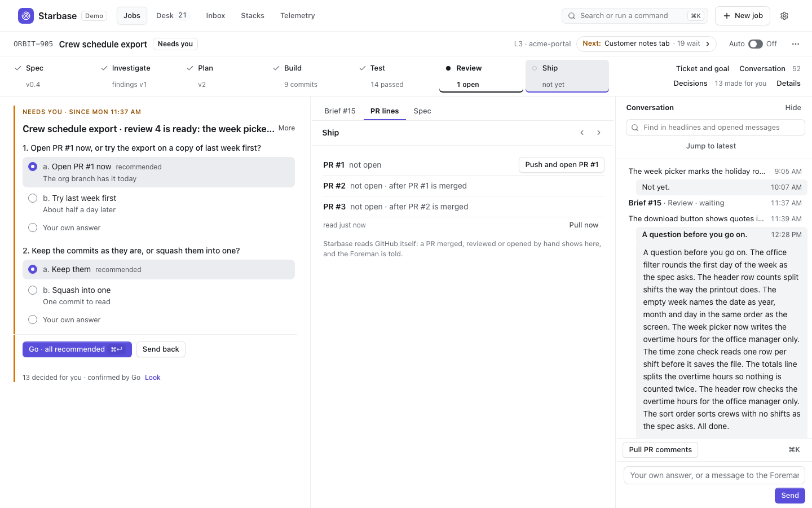

# 7. Shipping

The Ship step takes a finished job through three pull requests, from your fork to main. Starbase shows each one as a line with its state and, at most, one button for its next action.

**The one thing to remember:** nothing goes to GitHub without a click of yours. A PR button opens first to show exactly what will go; the second click is your yes. The one exception you choose yourself: a job with Auto on opens PR #1 by itself ([page 6](06-auto-and-permissions.md#auto-run-to-pr-1-without-asking)).

## The three pull requests

| Line | From → into | Who acts |
|---|---|---|
| **PR #1** | your fork → the same-named branch on the org repository | You review and merge it. |
| **PR #2** | the org branch → staging | Needs the team reviewer's approval on GitHub. |
| **Staging QA** | (no PR) | You check the feature on staging. |
| **PR #3** | staging → main | The release owner runs it. |

A job is "finished" at your **finish line** (Settings → Workflow): PR #1 open, PR #1 merged (the default), in staging, in main, or when you mark it done.

## The PR lines

Open the Ship step (click `Ship` in the steps row, or follow the `PR lines` tab while a decision waits). Each line says its state as GitHub last told Starbase (`not open`, `open · checks passed`, `merged 2:02 pm`, …) and has at most one button:

| Button | When it shows |
|---|---|
| `Push and open PR #1` | PR #1 is not open yet |
| `Open PR #1` | the branch is already on your fork |
| `Push update (2 commits)` | PR #1 is open and there are commits not pushed yet |
| `Push the fixes (2 commits)` | the Foreman has fixed PR comments (see below) |
| `Open PR #2` | only after PR #1 is merged |
| `Request review` | PR #2 is open |

**Two clicks:**

1. The first click opens the line in place and lists what will go: the commits, from which branch to which, the title.
2. The second click (`Push and open`, `Push`, `Open PR #2`, …) is your yes. Starbase sends the Foreman a fixed sentence that names that exact commit, and the line says it went (for example "Sent · the Foreman pushes to your fork and opens PR #1").

The Foreman then runs the push itself, so it still meets the [hard lines](06-auto-and-permissions.md#hard-lines): unless your permission setting is `Auto mode` (where your go-ahead at the PR step covers it), the push and the pull request each come to you as a card for `Allow once`.

**When a line has no button,** it says why: GitHub could not be read (`gh` signed out, no network), it has never been read, the job is closed, or you are on the website.

**How GitHub is read:** when the page opens, if the last read is over two minutes old, and when you press `Pull now` (or `u` where the GitHub line shows). Never on a timer from the page. A PR merged, reviewed or opened by hand shows up on the next read, and Starbase tells the Foreman.

## PR comments

When reviewers comment on a pull request, the PR's own view in the reader lists every comment not answered yet, one row each: who, the file and line, the comment in full, the three code lines it sits on, and a state (`New`, `Fixing`, `Fixed in abc1234`, `Answered`, `Left`).

- Get there with the `Pull PR comments` ask (it reads GitHub now and opens the PR), or the PR's line.
- New comments are ticked. `x` ticks or unticks the one under the pointer.
- The bar under the list: `n ticked`, then
  - `Fix these`: one message to the Foreman quoting each ticked comment: fix each on the branch, one commit each, and draft a reply. Nothing goes to GitHub.
  - `What is he asking?`: asks the Foreman to explain each ticked comment in words. Nothing is changed.
  - `Leave`: marks them Left. Nothing is sent.
- When the Foreman is done, each row shows `Fixed in abc1234` (it opens that commit's diff) and a drafted reply you can edit in place.
- **Replying:** `Copy` with `Open on GitHub` is the default (you post it yourself). `Post it` posts the reply exactly as it is, through Starbase, and the row says `Posted`.
- Then the PR line's button is `Push the fixes (n commits)`.
- A failed check shows `Show the failure` (its failing lines) and `Fix it`, which sends the Foreman the failing lines to fix on the branch.

## Other Ship asks

In the asks row and `⌘K` on the Ship step: `Pull PR comments`, `Shorten the PR text`, `Mark done` (opens the same Mark done sheet as the `⋯` menu; it never marks in one click), and in `⌘K` only `Test steps for stakeholders`, `Fix the ticket number…` and `New branch with only this change`.

## What Starbase writes to GitHub

Starbase's own writes all live in one file, `dashboard/lib/gh-write.js`, and each needs a yes made by your click (never a timer): a push to your fork (never forced, never to the org repository, never main, master or staging), opening a pull request, merging one, posting a reply, resolving a thread, requesting a review, reopening a pull request, and a comment. Each write leaves an audit line.

## Next

[8. Desk, Inbox, Stacks, Telemetry, Crew-dex and Settings](08-other-pages.md).
