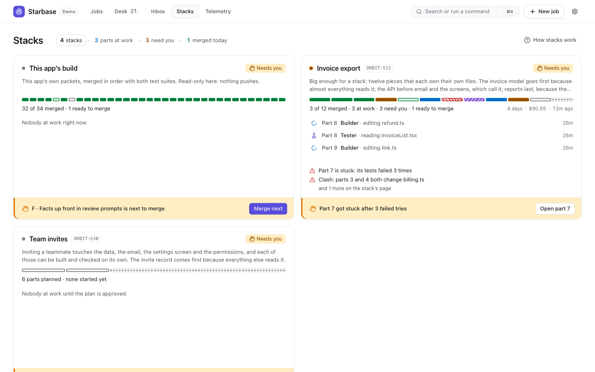
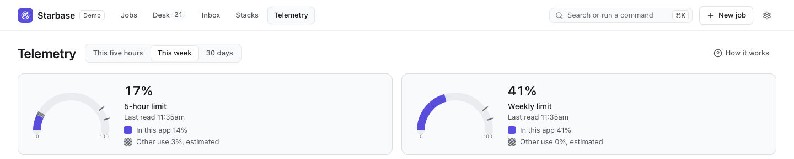

# 8. Desk, Inbox, Stacks, Telemetry, Crew-dex and Settings

The other pages in the top bar, each in a few lines: what it is for, its main buttons and its keys.
Every page has `How it works` at the top right, which opens its three guide cards again.

**The one thing to remember:** the Desk and the Inbox are where work comes in (decisions and tickets); Stacks, Telemetry and Settings are where you look things up.

## Desk

Every decision waiting for you, from every job, one at a time, oldest first: a go-ahead, a question or a permission. `a` for go, `r` for send back, `c` to reply. After you decide, the next one opens. Full detail and keys are on [page 5](05-deciding.md#the-desk-every-decision-one-at-a-time).

## Inbox

Your Orbit tickets (the Portal Feedback tickets assigned to you), in the order of your queue in Orbit. Starbase only reads Orbit; nothing here writes to it.

- **Before the first use** the Inbox asks for your Orbit token: make a read-only token on Orbit's API tokens page and paste it in Settings → Workflow (or run `starbase token set`). It is kept in your Keychain.
- **Tabs:** `Mine` (open tickets assigned to you), `Auto` when Auto start is set up (tickets carrying your tag: `Next up`, `Auto is working on these`, `Too big for Auto`, `Couldn’t start`), then your saved views from Orbit.
- **A row** shows severity, key and title, age, who is on it, and `Start` (or a link to the job already on that ticket). Click a row to open the ticket: its facts, description, links and timeline.
- **`Start`** (`s`) opens New job with the ticket filled in. The Foreman reads the ticket first and writes a brief. **`Shift+S`** starts it as a stack, for a big ticket.
- While the page is open Starbase checks Orbit every 3 minutes (every 15 otherwise).

## Stacks

A big ticket split into parts that don't touch each other's files. Each part gets its own Foreman and its own copy of the code; parts are merged one at a time, in order, and nothing leaves your computer until you say go.

- **The Stacks page** shows each stack as a card: its progress bar (a segment per part), who is at work, problems (a part stuck, two parts changing the same file) and its one next step (`Merge next`, `Open part 7`, …).
- **A stack's page** (`#/stack/<name>`): the parts as a `Board` (key `1`), a `Map` of what waits on what (`2`) or a `Timeline` (`3`); a quick look at a part (`Space`, then `j` `k`); `Details` (`d`) with the stack's settings, its plan and its history.
- **The one next action** on a stack: approve the plan (`a`), merge the next part (`m`), push (`p`: always asks go or no go first), open the part that needs you (`o`), let the Foreman fix a clash or a stuck part (`f`), or change something (`r`).
- Each part also has its own page (`#/stack/<name>/part/<n>`) and its own job.

## Telemetry

Where the Claude usage goes and when the limit will be reached.

- **The two dials:** the 5-hour limit and the weekly limit, each split into this app's use and other use (estimated). `Read now` (`r`) reads them again.
- **Who used this week's limit:** one segment per person, plus other use.
- **The window:** `This five hours`, `This week` or `30 days`.
- **Up to ten graphs** below, each headed by what it found (for example what a finished ticket costs, and where the spend goes by stage), with `Fold` and `Hide`. Hidden graphs come back from "Show hidden graphs".
- Settings → Workflow decides whether your Claude Code use outside Starbase is counted too.

## Crew-dex and Play

**Play** (Settings → Play) adds a crew that acts out what each job is really doing. `Off` turns it all off; `Subtle` keeps it small; `Full` adds the **Station**, a 3D deck on Jobs where a feature is a construction bay and a bug fix is a repair dock. Every state is also written in words.

With Play on, the gear menu also has:

- **Crew-dex** (`g` then `x`): a card per crew member (#001 to #015) with their role, model and what they have done on your jobs. Ones you haven't met yet are silhouettes.
- **Achievements**: what you have unlocked by finishing work, and the secrets you have found.

## Settings

`g` then `s`, or `Settings` in the gear menu. `Find a setting` (key `/`) searches every control; `j` and `k` move between sections.

| Section | What it holds |
|---|---|
| Permissions | How much the Foreman and its crew may do without asking you ([page 6](06-auto-and-permissions.md)). |
| Notifications | What Starbase tells macOS, and this browser's own alerts. |
| Look | Theme (13 of them, two unlocked through Play), text size, following the system's light or dark, the Desk and Jobs layouts, and Play. |
| Keys | Keyboard shortcuts on or off, and the key hints on buttons. |
| Workflow | The finish line, how often GitHub is checked, what a new job starts with, Auto start, your Orbit token, and whether Telemetry counts your Claude Code use. |
| Repos | The repositories Starbase knows, and the profile each one follows. |
| Play | The crew, achievements and sounds. |
| Rules | The `Always allow` rules you saved from permission cards. Remove one here. |

## Next

[9. The website](09-the-website.md).
